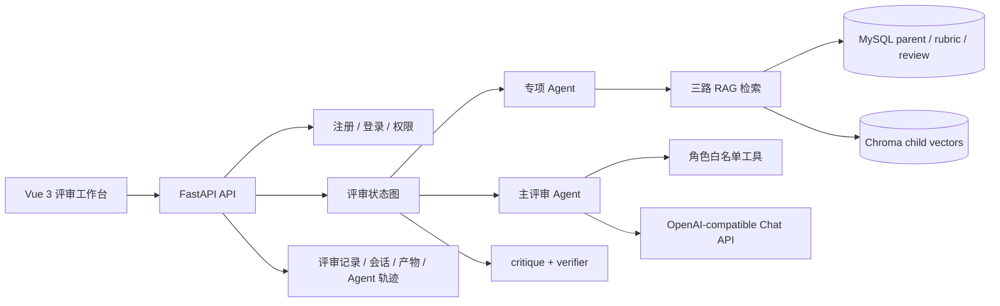

# paper-review

竞赛论文预审工作台：解析论文章节，依据已发布赛题量规逐维检索证据、选择档位、执行一致性审查，并生成可追溯的修改清单。项目是一套带人工确认、RAG 检索、专项 Agent、主评审 Agent 和 verifier 的 Agent 工作流系统，同时提供独立的评审记录问询功能。

## 项目简介

### 业务流程

```text
上传 Markdown / DOCX
        ↓
章节解析 → 人工确认章节类型
        ↓
按量规维度检索证据
        ↓
证据 Agent / 题目匹配 Agent / 结构 Agent
        ↓
主评审 Agent 选档与提交
        ↓
原句连续性校验 → critique → verifier 复核
        ↓
评审报告、修改建议、评审记录和 Agent 轨迹
```

### 设计边界

- 引用必须是论文父块中的连续原句，不能用模型摘要冒充引用。
- 检索不到足够证据时标记“证据不足”，不强行换算分数。
- verifier 只能保持或向下调整主评审结果，不能越权升档。
- 章节确认是评分前的人工中断点，确认后才开始检索和评分。
- 在线上传支持 `.md` 和 `.docx`；PDF/OCR 在系统外完成后再导入。
- 不输出奖项、名次和获奖概率。

## 技术栈

| 层次 | 技术 | 用途 |
|---|---|---|
| 后端 | Python 3.11、FastAPI、Uvicorn、Pydantic | API、校验、健康检查、设置和异常处理 |
| Agent 编排 | LangGraph、LangChain、LangChain Core | 章节确认中断、专项 Agent、主 Agent、工具调用和 verifier |
| 模型接入 | OpenAI-compatible Chat / Embedding / Rerank API | 统一模型出口、工具调用、向量生成和重排 |
| 数据访问 | SQLAlchemy、PyMySQL、MySQL 8.4 | 赛题量规、评审、用户、会话、父块、产物和轨迹 |
| RAG | Chroma child 向量、MySQL parent 全文、三路召回、Rerank | 证据检索、父子块回填、去重和引用追踪 |
| 前端 | Vue 3、TypeScript、Vue Router、Element Plus、ECharts | 论文解析、评分、审查、建议、记录、问询和大屏 |
| 工程化 | Vite、Vitest、Playwright、Docker Compose | 构建、单元测试、E2E、视觉验收和部署 |
| 可观测性 | JSON 轮转日志、Prometheus 文本指标、Agent trace | 模型调用、检索、评审、聊天、鉴权和错误追踪 |

## 系统结构



## 目录结构

```text
paper-review/
├── backend/
│   ├── app/
│   │   ├── api/               FastAPI 应用、评审、认证、聊天、设置和大屏接口
│   │   ├── agent/             Agent 上下文、工具、提示词、模型适配、运行器和轨迹
│   │   ├── graph/             章节解析、人工确认、检索、评分状态图
│   │   ├── retrieve/          父子块模型、三路召回和 Rerank
│   │   ├── scoring/           选档、引用校验、降档守卫和加权汇总
│   │   ├── report/            评审报告、修改清单、评测和产物
│   │   ├── importing/         赛题包、DOCX、样例和数据库导入
│   │   ├── chat/              记录问询、会话、分析和摘要
│   │   ├── auth/              用户、Token、角色和权限
│   │   ├── llm/               唯一模型 HTTP 出口：Chat、Embedding、Rerank
│   │   ├── observability/     JSON 日志和指标
│   │   └── settings/          首次配置和运行时配置
│   ├── tests/                 Agent、RAG、报告、认证、设置和 API 测试
│   ├── requirements.txt       后端锁定依赖
│   ├── Dockerfile             后端镜像
│   └── docker-entrypoint.py  容器启动和非 root 用户切换
├── frontend/
│   ├── src/views/             解析、评分、审查、建议、评测、记录、问询、设置和大屏
│   ├── src/components/        导航、阶段条、维度卡、证据、轨迹、产物和聊天组件
│   ├── src/api/               API 类型和请求封装
│   ├── src/composables/       登录、主题、评审流和结果结构
│   ├── tests/unit/             Vitest 单元测试
│   ├── tests/e2e/              Playwright 浏览器验收
│   ├── Dockerfile              Nginx 前端镜像
│   └── nginx.conf              `/api` 反向代理和静态资源配置
├── data/
│   ├── contests/               赛题、量规、约束、陷阱和优秀样例
│   ├── samples/                论文样例和评测输入
│   └── eval/                   Gold 数据与评测样例
├── docs/                       项目事实、版本记录、面试材料、架构图和验收记录
├── scripts/                    OCR、索引、批处理、评测和运维检查
├── compose.yaml                frontend / backend / mysql 编排
├── deployment-state/           容器首次配置状态
└── .env.example                数据库、认证、Chat、Embedding、Rerank 配置模板
```

## 快速开始

### 本地运行

#### 环境要求

- Python 3.11+
- Node.js 22+
- MySQL 8.4+
- 可选：Chroma 持久化目录或 Chroma 服务
- 一个 OpenAI-compatible Chat 服务，以及可选的 Embedding 和 Rerank 服务

#### 1. 安装依赖和配置

```powershell
Copy-Item .env.example .env
$py = 'D:\LEARN\AI\programs\AgentTask\env\agent-task\Scripts\python.exe'
& $py -m pip install -r backend/requirements.txt
Set-Location frontend
npm ci
Set-Location ..
```

编辑 `.env`：

| 变量 | 说明 |
|---|---|
| `MYSQL_DSN` | MySQL SQLAlchemy 连接串 |
| `AUTH_SECRET` | Token 密钥；生产环境使用随机长密钥 |
| `LLM_BASE_URL` / `LLM_API_KEY` / `LLM_MODEL` | Chat 和工具调用服务 |
| `EMBEDDING_BASE_URL` / `EMBEDDING_API_KEY` / `EMBEDDING_MODEL` | 向量服务；地址可回落到 Chat 地址 |
| `RERANK_BASE_URL` / `RERANK_API_KEY` / `RERANK_MODEL` | 可选重排服务 |

配置界面也可以在首次启动后通过 `/setup` 写入本机 `.env`，密钥不会回显到 API、日志和代码。

#### 2. 显式建表

应用启动不会隐式建表。先启动 MySQL，再执行以下一次性初始化：

```powershell
$env:PYTHONPATH = (Get-Location).Path
& $py -c "from backend.app.importing.db import create_schema; from backend.app.auth.models import create_auth_schema; from backend.app.retrieve.models import create_parent_schema; from backend.app.report.models import create_report_schema; from backend.app.report.artifact_models import create_artifact_schema; from backend.app.chat.models import create_chat_schema; from backend.app.agent.trace import create_agent_trace_schema; create_schema(); create_auth_schema(); create_parent_schema(); create_report_schema(); create_artifact_schema(); create_chat_schema(); create_agent_trace_schema()"
```

#### 3. 启动后端

```powershell
& $py -m uvicorn backend.app.api.app:app --host 127.0.0.1 --port 8077
```

后端地址：`http://127.0.0.1:8077`；接口文档：`http://127.0.0.1:8077/docs`。

#### 4. 启动前端

```powershell
Set-Location frontend
npm run dev
```

前端地址：`http://127.0.0.1:5173`。Vite 将 `/api` 代理到 `http://127.0.0.1:8077`。

健康检查：

```powershell
Invoke-RestMethod http://127.0.0.1:8077/health
Invoke-RestMethod http://127.0.0.1:8077/readyz
```

`/readyz` 会检查 MySQL 和 Chroma；模型路径是否启用由 `LLM_*`、`EMBEDDING_*` 和 `RERANK_*` 配置决定。未配置模型时，部分评审和评测功能可以走确定性回退。

#### 5. 导入赛题和样例

赛题包位于 `data/contests/`。导入后通过管理接口或前端发布赛题和量规：

```powershell
& $py scripts/check_eval_gold.py
```

完整的导入、发布和首次配置步骤见 [PROJECT_DOC.md](docs/version/Final_version/PROJECT_DOC.md)。

### Docker 部署运行

#### 1. 准备环境变量

```powershell
Copy-Item .env.example .env
# 编辑 .env，至少填写 MySQL、AUTH_SECRET 和模型服务配置
```

#### 2. 构建并启动

```powershell
docker compose up -d --build frontend backend mysql
docker compose ps
docker compose logs -f backend
```

容器职责：

| 容器 | 端口 / 访问方式 | 说明 |
|---|---|---|
| `frontend` | 宿主机 `80` | Nginx 静态资源和 `/api` 代理 |
| `backend` | Compose 内部 `8077` | FastAPI、Agent、RAG 和设置接口 |
| `mysql` | Compose 内部 `3306` | 业务库和评审数据 |

#### 3. 建表和首次配置

Compose 不会自动建表，也不会自动导入或发布赛题量规。容器启动后执行：

```powershell
docker compose exec backend python -c "from backend.app.importing.db import create_schema; from backend.app.auth.models import create_auth_schema; from backend.app.retrieve.models import create_parent_schema; from backend.app.report.models import create_report_schema; from backend.app.report.artifact_models import create_artifact_schema; from backend.app.chat.models import create_chat_schema; from backend.app.agent.trace import create_agent_trace_schema; create_schema(); create_auth_schema(); create_parent_schema(); create_report_schema(); create_artifact_schema(); create_chat_schema(); create_agent_trace_schema()"
```

然后打开 `http://127.0.0.1`，进入 `/setup` 完成首次配置，或使用接口导入并发布赛题。

#### 4. 停止和清理

```powershell
docker compose down
# 删除持久化数据时才使用：
docker compose down -v
```

Compose 卷包括 MySQL、Chroma、日志、上传文件和部署状态；删除卷会清空相应数据。

## 页面与路由

### 前端页面路由

| 页面 | 前端路由 | 主要用途 | 权限 |
|---|---|---|---|
| 首次配置 | `/setup` | 写入数据库、认证和模型配置 | 公开初始化入口 |
| 登录 | `/login` | 用户登录和 Token 恢复 | 公开 |
| 注册 | `/register` | 创建普通用户 | 公开，后端控制 |
| 论文解析 | `/parse` | 上传论文、解析章节、人工确认章节类型 | 登录 |
| 分项评分 | `/scoring` | 展示各量规维度、证据、档位和加权结果 | 登录 |
| 一致性审查 | `/consistency` | 展示跨章节冲突、数字冲突和结构问题 | 登录 |
| 修改建议 | `/suggestions` | 展示可追溯修改清单和证据依据 | 登录 |
| 评测对照 | `/eval`、`/eval/:paperId` | 查看 Gold、系统结果和逐维差异 | 登录 |
| 记录总览 | `/records` | 查看历史评审、筛选和详情抽屉 | `review:read:all` |
| AI 问询 | `/chat` | 以评审记录为范围进行问询、分析和摘要 | `chat:use` |
| 数据大屏 | `/dashboard` | 评审量、趋势、维度和系统指标 | `dashboard:view` |

### 页面与接口对照

| 页面 | 调用接口 | 方法 | 说明 |
|---|---|---|---|
| 首次配置 | `/api/setup/status` | GET | 查询是否完成首次配置 |
| 首次配置 | `/api/setup/config` | POST | 使用 bootstrap token 保存初始配置 |
| 设置 | `/api/settings/config` | GET / PUT | 读取或更新运行配置 |
| 登录 / 注册 | `/api/auth/register`、`/login`、`/logout`、`/me` | POST / GET | 用户注册、登录、退出和当前用户 |
| 论文解析 | `/api/samples` | GET | 加载示例论文 |
| 论文解析 | `/api/uploads` | POST | 上传 `.md` / `.docx` 文件 |
| 论文解析 | `/api/reviews` | POST | 创建评审、解析章节并停在人工确认点 |
| 论文解析 | `/api/reviews/{review_id}/resume` | POST | 提交确认后的章节树，继续检索和评分 |
| 分项评分 | `/api/reviews/{review_id}` | GET | 读取评审报告、档位、引用和汇总 |
| 分项评分 | `/api/reviews/{review_id}/agent-steps` | GET | 查看 Agent 步骤和工具轨迹 |
| 一致性审查 | `/api/reviews/{review_id}` | GET | 读取评审中的一致性结果和修改清单 |
| 修改建议 | `/api/reviews/{review_id}/artifacts` | GET | 读取评审产物 |
| 修改建议 | `/api/reviews/{review_id}/artifacts/extract` | POST | 从论文中提取并保存可回定位产物 |
| 记录总览 | `/api/reviews` | GET | 按赛题、用户、归属和分页读取评审 |
| 评测对照 | `/api/eval/summary`、`/api/eval/papers/{paper_id}` | GET | 读取评测汇总和单篇逐维差异 |
| 赛题管理 | `/api/contests`、`/{contest_id}/rubric` | GET | 读取赛题和当前已发布量规 |
| 赛题管理 | `/api/imports` | POST | 导入赛题包 |
| 赛题管理 | `/api/contests/{contest_id}/publish`、`/archive` | POST | 发布或归档赛题 |
| 量规管理 | `/api/contests/{contest_id}/rubrics` | POST | 从当前量规复制草稿 |
| 量规管理 | `/api/rubrics/{rubric_id}/publish` | POST | 发布指定版本量规 |
| AI 问询 | `/api/chat/sessions` | GET / POST / DELETE | 查询、新建和删除问询会话 |
| AI 问询 | `/api/chat/sessions/{session_id}/messages` | GET / POST | 读取历史消息和发送问题 |
| AI 问询 | `/api/chat/analytics`、`/summary` | POST | 执行记录分析和摘要 |
| 数据大屏 | `/api/dashboard/summary`、`/trend` | GET | 读取汇总指标和趋势 |
| 健康检查 | `/health`、`/readyz`、`/metrics` | GET | 存活、依赖就绪和 Prometheus 指标 |

所有接口都可以通过 `/docs` 和 `/openapi.json` 查看机器可读契约。认证接口返回 Token，受保护接口使用 `Authorization: Bearer <token>`。

## 核心能力

### 评审状态图

固定流程为 `parse → confirm → retrieve → score → report`：

- `parse` 按 ATX 标题切分章节并识别假设、模型、求解、结果、检验和参考文献。
- `confirm` 通过 LangGraph `interrupt()` 暂停，等待用户确认章节类型。
- `retrieve` 按量规维度检索父块，记录命中、证据不足、查询和检索轮次。
- `score` 由模型选择档位，确定性代码校验 JSON、引用、档位枚举和权重。
- `critique` 检查引用、档位和跨维度问题；`verifier` 只能保持或降档。

### 多 Agent 与工具契约

- `evidence_agent`：为维度准备经过原文校验的证据包。
- `topic_fit_agent`：判断论文与赛题要求的匹配情况。
- `coherence_agent`：发现跨章节、数字和论证结构问题。
- `review_agent`：根据证据和量规逐维提交档位。
- `verifier_agent`：复核主评审结果，只允许保持、降档或标记证据不足。
- 工具按角色白名单注册，参数通过 Pydantic schema 校验，并保留 Agent 步骤和调用摘要。

### RAG 检索

- 子块向量存入 Chroma，父块全文存入 MySQL `paper_parent`。
- 三路召回后合并去重，按评审、维度、章节类型和量规过滤。
- 可配置 Rerank，最终最多回填 4 个父块。
- 引用必须是父块 `content` 的连续子串，避免生成不存在的证据。
- 没有模型或外部依赖时，部分评测使用 `source=deterministic` 的结构化回退，回退结果不等同于模型准确率。

### 数据、权限和可观测性

- MySQL 保存赛题包、量规、评审、章节快照、聊天、产物、用户和 Agent 轨迹。
- 旧评审绑定当时的赛题和量规版本，不因后续量规发布而回写。
- 支持学生、教师等权限边界，教师可以读取全量评审和管理赛题量规。
- JSON 日志按模块轮转，指标覆盖评审、模型调用、检索、认证、聊天和错误。
- `/readyz` 返回 MySQL、Chroma 和集合数量检查结果，便于容器健康检查。

## 视觉设计

前端采用“手稿式研究工作台”方向，把论文阅读、证据定位和评审判断放在同一视觉上下文中：

- 使用纸张底色、照片背景、线稿插图和轻量阴影，弱化传统后台的冷硬表格感。
- 通过靛蓝、墨黑和暖灰构成主色，绿色表示已完成，橙色表示待确认，红色表示冲突、失败或证据风险。
- 通过阶段条、编号动效、维度卡片和证据抽屉体现评审进度。
- 保留 `prefers-reduced-motion` 处理，减少动画对可访问性的影响。
- 主题变量集中在 `frontend/src/styles/tokens.css` 和 `frontend/src/styles/sketch.css`，组件不直接散落颜色值。

## 页面设计

### 论文解析

左侧展示章节树，右侧展示章节内容和类型选择；上传后先完成解析，用户确认章节类型后才进入评分。

### 分项评分

以维度卡片展示量规、证据原文、引用位置、当前档位、状态和权重。证据不足明确显示原因，不用空分数伪装成完成。

### 一致性审查

按冲突类型、严重程度和涉及章节列出问题，支持从问题跳回原文片段。

### 修改建议

每条建议关联评审维度、证据、章节和可执行修改动作，重点展示“为什么要改”和“改哪里”。

### 记录总览

教师视角支持按赛题、用户、归属和时间分页筛选；详情抽屉展示报告、阶段、Agent 轨迹、产物和状态变化。

### AI 问询

问询范围绑定评审记录和赛题，支持会话历史、记录级回答、分析和摘要，避免脱离评审证据泛化回答。

### 数据大屏

通过评审数量、维度分布、趋势和运行指标展示系统使用情况；普通读取不隐式触发新的模型调用。

## 模型来源与配置

项目只在 `backend/app/llm/client.py` 统一发起模型 HTTP 请求，业务模块通过环境变量选择供应商和模型：

| 能力 | 环境变量 | 请求接口 | 说明 |
|---|---|---|---|
| Chat / 工具调用 | `LLM_BASE_URL`、`LLM_API_KEY`、`LLM_MODEL` | `/chat/completions` | 使用 OpenAI-compatible 请求和工具调用格式 |
| Embedding | `EMBEDDING_BASE_URL`、`EMBEDDING_API_KEY`、`EMBEDDING_MODEL` | `/embeddings` | 地址和密钥为空时可回落到 Chat 配置 |
| Rerank | `RERANK_BASE_URL`、`RERANK_API_KEY`、`RERANK_MODEL` | `/rerank` | 可选；未配置时不强行伪装为真实重排 |

代码中的 `DeepSeekChatModel` 是 LangChain 适配器名称，实际模型由 `LLM_MODEL` 决定。项目可以接入 DeepSeek、OpenAI、Azure OpenAI、私有模型网关或其他兼容服务；仓库默认模板不包含真实模型地址和密钥。

## 版本控制

- Git 仓库：[aaGlaming/paper-review](https://github.com/aaGlaming/paper-review)
- 当前前端包版本：`0.9.0`；后端 FastAPI 应用版本：`0.3.0`。
- 推荐提交格式：`feat:`、`fix:`、`docs:`、`test:`、`refactor:`、`chore:`。
- 评审状态、章节类型、档位词表和 API 路径属于冻结契约，修改时需同步更新前端类型、后端校验和测试。
- `.env`、数据库密码、模型密钥、Chroma 数据、运行日志和上传文件不得提交。
- 评审算法、量规、提示词、模型配置和评测结果需要保留版本来源，避免把历史评审误读为新量规结果。
- 推送前至少检查后端测试、前端 `npm run build`、单元测试、E2E 验收和 `/readyz` 依赖状态。

## 相关文档

- [详细项目文档](docs/version/Final_version/PROJECT_DOC.md)
- [项目事实清单](docs/项目事实清单.md)
- [项目讲解逐字稿](docs/项目讲解逐字稿.md)
- [Archify 架构图索引](docs/version/Final_version/archify/INDEX.md)
- [部署运维手册](docs/腾讯云Docker-Compose运维手册.md)
- [评测与验收记录](docs/plan/acceptance/)

## License

仓库当前未提供独立 `LICENSE` 文件，使用和再分发前请先确认授权范围。
