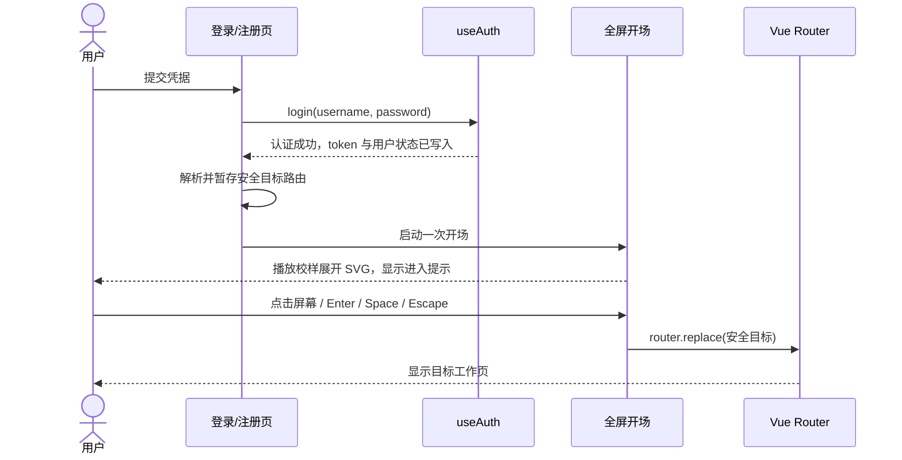

# 前端层次感与登录后开场动画方案

## 目标

在保留“竞赛论文预审工作台”现有校样稿、手绘批注风格的基础上，增强页面的空间层级，并在用户成功登录后播放一次 SVG 开场动画。动画播放时停留在当前登录入口；用户点击屏幕、按 Enter/Space 或 Escape 后，进入原本要去的系统页面。

本文件是审查与设计方案，**本次没有修改前端应用代码**。

## 源码审查

### 当前视觉基础

- [tokens.css](../../../frontend/src/styles/tokens.css) 已有冷纸色、墨色、蓝色操作色、冲突语义色，并统一管理字体、间距、圆角和主题变量。浅色/深色主题共用同一套语义。
- [sketch.css](../../../frontend/src/styles/sketch.css) 已提供纸张颗粒、手绘边框、胶带、页边线稿和全局 `:focus-visible` 样式；[PageArt.vue](../../../frontend/src/components/PageArt.vue) 提供页面装饰图。
- 当前层级主要依赖纸底、细边框、留白和手绘线稿。普通卡片不加阴影是已有设计选择；`--pr-shadow-paper` 用于少数重点交互面，`--pr-shadow-overlay` 用于浮层。

### 与本次目标相关的发现

| 发现 | 代码证据 | 对方案的影响 |
|---|---|---|
| 登录和注册页也被全局导航包裹。 | [App.vue](../../../frontend/src/App.vue):9–14 无条件渲染 `AppNav`；[AppNav.vue](../../../frontend/src/components/AppNav.vue):9–25 会展示无权限门槛的主流程入口。 | 登录场景应成为独立的认证入口；成功动画覆盖期间不应露出后台导航。建议在认证公开路由隐藏导航，退出动画后再显示。 |
| 登录成功后立即跳转，没有过渡状态。 | [登录.vue](../../../frontend/src/views/登录.vue):29–42 在 `login()` 成功后立即执行 `router.replace()`。 | 动画应插入“认证成功”和“导航到安全重定向目标”之间，保留现有 `resolveRedirect()` 防开放重定向逻辑。 |
| 注册成功会自动登录并直接进入解析页。 | [注册.vue](../../../frontend/src/views/注册.vue):49–60 注册后调用 `login()`，随后跳转 `/parse`。 | 建议把它视作一次交互式登录，复用同一开场；从已有 token 恢复会话时不播放。 |
| 全局动效刻意克制，但没有 reduced-motion 处理。 | [tokens.css](../../../frontend/src/styles/tokens.css):58–64 规定普通卡片不加阴影、动效仅留章节确认；`frontend/src` 当前未检出 `prefers-reduced-motion`。 | 新动画作为唯一全屏动效，并尊重系统减少动态效果设置；不要给所有卡片同时增加入场动画。 |
| 登录卡片的圆角引用了未定义令牌并回退到 8px。 | [登录.vue](../../../frontend/src/views/登录.vue):86–95 使用 `var(--pr-radius-card, 8px)`；全局现有圆角令牌是 `--pr-radius: 4px`。 | 视觉改造时统一令牌，避免认证页和工作台的组件形状脱节。 |
| 键盘焦点已有全局替代样式。 | [sketch.css](../../../frontend/src/styles/sketch.css):264–271 以 `:focus-visible` 和主题焦点环替代默认轮廓。 | 开场按钮复用焦点令牌，并提供键盘和屏幕阅读器可理解的跳过方式。 |

## 视觉方向：校样台的纸张层叠

不把界面改成通用仪表盘式“卡片堆叠”。立体感来自纸张之间可读的前后关系、内容分组和边缘，而不是给每个容器加模糊阴影。

### 四层空间关系

1. **桌面层**：保留现有主题底色、低对比纸纹、页边线稿和页面插画。背景只做氛围，不承载正文对比度。
2. **工作纸层**：每页的主要阅读/操作区作为一张完整校样纸，边界和留白比普通内容更明确；在标题、正文、批注边栏之间建立固定间距和基线。
3. **重点纸层**：每页只挑一个主工作面或当前选中项，使用极轻的硬边错位纸影，或用伪元素画出第二张略偏移的纸边。不要让所有量规卡、统计卡同时浮起。
4. **批注与浮层**：引用、状态和局部说明使用浅底、左侧批注线、内凹底色或压纸标记分组；抽屉、菜单和对话框继续使用已有浮层阴影令牌。

### 令牌建议

继续只在 `tokens.css` 管理颜色与深度令牌，并让浅色、深色主题分别定义阴影透明度。建议统一为有语义的层级：

| 层级 | 用途 | 建议表现 |
|---|---|---|
| `surface` | 普通正文与卡片 | 纸底 + 细边线，无阴影 |
| `sheet` | 当前页主要工作区 | 一条明确纸边 + 轻微硬边错位影 |
| `focus` | 当前选中维度、定位证据或主操作 | 语义色边线/纸夹标记 + 短距离层差 |
| `overlay` | 抽屉、菜单、弹层 | 复用 `--pr-shadow-overlay`，只高于页面内容 |

颜色沿用现有墨色、校样蓝、冲突红、证据不足灰和越界赭色，不新增发光、渐变或无语义装饰色。尺寸仍从现有 4px 间距体系派生。深色主题必须单独检查纸影边界，避免黑底上的层次消失。

### 页面层次落点

- **全局导航**：作为桌面顶部的独立纸条，与正文通过下边线和轻微高度差分开；当前页面使用现有手绘下划线强调。小屏维持可换行/折叠后的清晰顺序，不把导航压到动画或正文下方。
- **解析页**：论文正文作为主纸面，章节树和产物面板为侧边批注层；定位结果用语义色与纸夹边界凸显。
- **评分、一致性、修改建议**：主维度/当前冲突作为重点纸层，其余条目维持平面列表和细边线；不要每项都做同强度阴影。
- **记录页**：表格作为主层，筛选和记录详情抽屉作为次层/浮层；抽屉继续有清楚的遮罩和边界。
- **大屏与评测页**：用分区、标题层级、细线和局部底色区分指标组，避免 8 个模块都变成同样漂浮的卡片。
- **登录/注册页**：独立认证画布，使用现有背景图和纸张纹理；表单卡只做一层稳定的纸面浮起，按钮和输入框保持清楚的焦点状态。

## SVG 开场动画

### 主题与画面

主题定为“论文校样展开，批注就位”。画面不使用机器人、星光或泛化 AI 光效，直接取材于系统的纸张、章节、量规和证据定位：

1. 一张校样纸从轻微错位状态归正，露出左侧页边距。
2. 章节标题线与正文行依次显现，表示论文结构就位。
3. 铅笔线在边栏勾出一处引用标记，再出现量规刻度/批注符号，表达“证据对照”而非“自动打分成功”。
4. 纸面停在完成构图，显示“预审工作台已就绪”及“点击任意位置进入”。

总时长建议约 2.5–3 秒，只播放一次，结束后停在最后一帧等待用户操作；用户在动画中途点击也立即跳过并进入系统。

### SVG 实现建议

- 新增一个专用的 `PostLoginIntro.vue`，内嵌 SVG，避免外部动效库和远程资源。SVG 使用 `currentColor` 与现有 CSS 变量，深浅主题均可读。
- 动画只包含一张主纸、少量正文线、一个边栏标注和最终就绪文案；不把整套页面缩小塞进 SVG。
- 线条绘制可只用于一条铅笔批注路径，其余元素用短促的 `opacity`/`transform` 出现；不做持续循环、闪烁和大幅缩放。
- `prefers-reduced-motion: reduce` 时不播放路径绘制和位移，直接展示最终静态画面与同一进入按钮。动作仍需用户确认，不应让减少动态效果的用户被自动跳转。
- 不依赖 SVG 的点击区域来实现交互；以覆盖全屏的语义按钮承接点击，屏幕阅读器名称为“跳过开场并进入工作台”。

## 登录与进入系统的流程

实施时遵守以下边界：

- 仅在显式登录成功后触发；用户名密码错误、请求失败、已有 token 的刷新/恢复均不触发。
- 成功认证后保留 `resolveRedirect(route.query.redirect)` 的结果，点击后 `router.replace()` 到该目标；不覆盖原有的站内路径检查。
- 开场完成前不切换目标页，避免目标页先渲染、再被动画盖住的闪屏。认证 token 已存在于当前登录状态，但目标页面要等用户确认后才进入。
- 注册页当前会自动登录后去 `/parse`。建议把它纳入同一“成功认证”过渡，目标固定为 `/parse`，避免注册用户绕过开场。
- `App.vue` 建议在 `route.meta.public` 时隐藏 `AppNav`，并让开场覆盖整个视口；结束后再显示受保护工作区与对应导航。
- 登出后不播放开场。失败与忙碌提示沿用现有表单语义，不放进 SVG 做装饰文字。

## 无障碍与交互要求

- 全屏画面本身是一个键盘可聚焦、可点击的进入动作；提供可见提示“点击任意位置，或按 Enter / Esc 进入”。使用原生按钮语义，避免只有 `div @click`。
- 任意点击、Enter、Space、Escape 均可结束；事件只执行一次，重复点击不会重复路由。
- 开场开始时焦点落在进入按钮；结束后将焦点交给目标页的主标题或主区域，避免焦点留在已卸载的登录表单。
- SVG 作为装饰时 `aria-hidden="true"`；状态文案由普通 HTML 文本提供，不把重要信息只画进 SVG。
- 尊重 `prefers-reduced-motion`；桌面、窄屏、深色主题均需检查。动画不得遮住错误提示或产生横向滚动。
- 动效尽量限制在少量 SVG 节点，控制在 3 秒左右；不添加大图 GIF、视频或额外动画依赖。

## 建议实施顺序

1. **建立视觉基线**：登录、解析、评分、一致性、修改建议、记录、大屏和评测页各取浅色/深色截图；同时检查 390px、768px 和桌面宽度。
2. **统一层级令牌**：补全少量有语义的纸面/重点/浮层深度令牌，先改全局导航、主工作面与选中项；逐页验证，不给所有卡片套阴影。
3. **整理认证壳层**：登录/注册路由隐藏工作台导航，修正登录卡片圆角令牌，使认证页成为独立入口。
4. **加入开场组件与状态流**：新建 SVG 开场组件及最小共享状态；登录成功后开始，用户确认后按安全目标导航。注册自动登录按同一规则处理。
5. **测试与回归**：补充登录成功显示动画、登录失败不显示、点击/键盘结束并按 redirect 进入、注册自动登录、已有会话刷新不播放、减少动态效果显示静态版等测试；回归现有登录、权限守卫、导航和路由用例。
6. **视觉验收**：截取动画开始/最终帧与各主要页面浅色/深色截图；检查纸张层级是否清楚、正文对比度是否保持、手稿语言是否一致。

## 验收标准

- 所有已登录业务页在桌面和窄屏都有清楚的“背景—工作面—重点/批注—浮层”层次；普通列表项仍保持克制，不出现全页卡片漂浮感。
- 登录与注册页面不显示业务导航；业务页面仍显示正确的角色权限导航。
- 只有认证成功后出现一次开场；任何失败、token 恢复和已登录刷新不触发。
- 动画可随时点击跳过；Enter、Space、Escape 行为一致；点击后进入原安全重定向目标，未带目标时进入 `/parse`。
- 减少动态效果时显示静态就绪画面并仍可确认进入。
- 浅色/深色主题、键盘焦点、屏幕阅读器文本、390px 窄屏均通过检查；无新增依赖。

## 本次审查范围与限制

本方案依据 `frontend/src` 源码审查整理，没有启动前后端，也没有对运行中的页面做截图审计。实施阶段应先按“建议实施顺序”采集真实页面基线，再按验收标准复核最终视觉效果。

界面动效与交互约束参考：[Web Interface Guidelines](https://github.com/vercel-labs/web-interface-guidelines/blob/main/command.md)，重点是减少动态效果支持、可键盘操作、焦点可见和避免持续循环动效。
