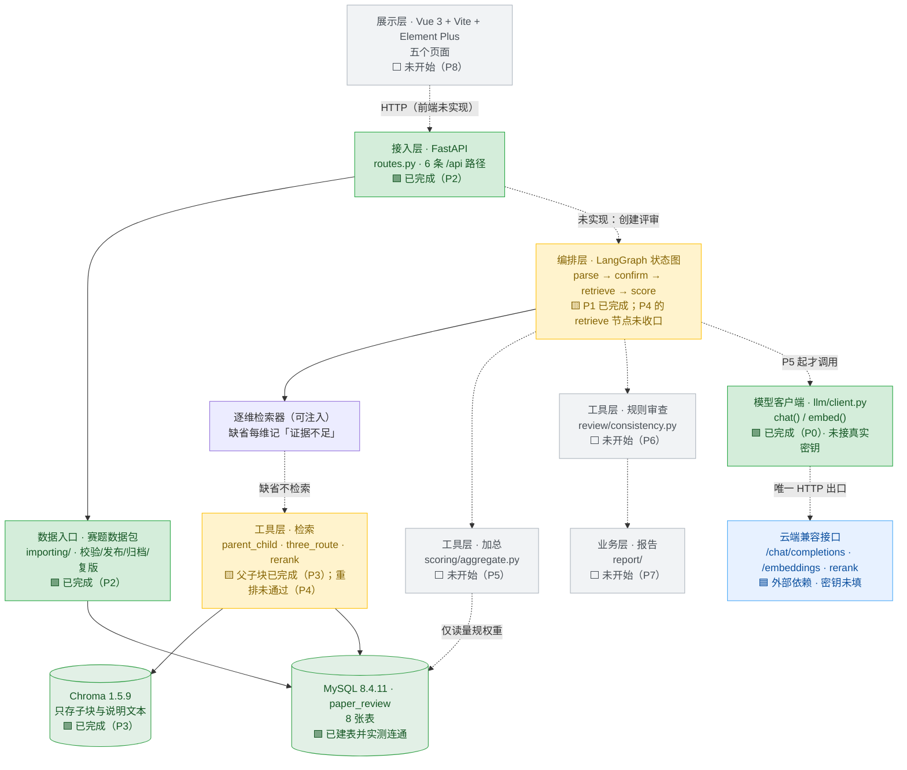

# paper-review 项目进度报告

> **生成时间**：2026-10-15 18:20
> **代码目录**：`D:\LEARN\AI\programs\AgentTask\Projects\paper-review`
> **解释器**：`D:\LEARN\AI\programs\AgentTask\env\agent-task\Scripts\python.exe`（Python 3.11.16）
> **数据来源**：全部为**实测**——`pytest` 实跑、`TestClient` 实捕获、`uvicorn` 实启动、全局 grep 实查；未使用推测值。
> **判定口径**：项目规矩是「`pytest` 退出码为 0 才写「通过」」（任务文档 §3.2）。本报告严格按此口径，**代码写完但测试未过 = 未通过**。

---

## 0. 现状摘要

| 里程碑 | 阶段 | 状态 | 关键判据 |
|---|---|---|---|
| v0.1.0 | P0 地基 | ✅ **通过** | `22 passed`，退出码 0 |
| v0.2.0 | P1 解析暂停 | ✅ **通过** | `11 passed`，退出码 0 |
| v0.3.0 | P2 赛题数据 | ✅ **通过** | `14 passed`，退出码 0，实连真 MySQL |
| v0.4.0 | P3 父子块检索 | ✅ **通过** | `14 passed`，退出码 0，真 Chroma + 真 MySQL |
| v0.5.0 | P4 重排与再检索 | 🔶 **未通过** | 代码已写、裁决已记，但 **`1 failed, 73 passed`**；`progress.md` 无本节、`task_plan.md` 仍标「未开始」 |
| v0.6.0 | P5 选档与加总 | ⬜ 未开始 | `scoring/aggregate.py` 仍为 4 行注释壳 |
| v0.7.0 | P6 规则审查与样例 | ⬜ 未开始 | `review/consistency.py` 仍为 4 行注释壳；样例论文未写 |
| v0.8.0 | P7 报告与评测 | ⬜ 未开始 | `report/__init__.py` 仍为 4 行注释壳 |
| v0.9.0 | P8 页面 | ⬜ 未开始 | `frontend/` 全部为 5～6 行注释壳 |
| v1.0.0 | 总验收 | ⬜ 未开始 | — |

**一句话**：后端数据通路（模型客户端 → 赛题入库 → 父子块检索）已打通并逐版验证；**智能评分链路尚未开始**，前端为零。当前有一个**中途留下的失败测试**需要先收口。

---

## 一、已实现的可验证内容清单

### 1.1 逐项验证台账

| # | 可验证内容 | 验证步骤 | 所需环境 | 判定标准 |
|---|---|---|---|---|
| 1 | **模型客户端契约**：`chat()` / `embed()` 只读约定字段，缺字段抛错而不返回空串 | `python -m pytest backend/tests/llm/test_client.py -q` | 解释器 `agent-task`；**无需网络**（`httpx.MockTransport` 注入） | 退出码 0；除 `llm/client.py` 外仓库内无第二处 HTTP 调用；仓库搜不到 `ollama` / `sentence-transformers` / `qwen2.5` |
| 2 | **章节确认与检查点**：未确认章节不进入评分；重启后从暂停点继续；空文档不产生 `review_id` | `python -m pytest backend/tests/graph/test_interrupt.py -q` | 无外部依赖（`InMemorySaver`，进程内） | 退出码 0；未 resume 时 `score_node_calls == 0`；同 `review_id` 重建图后仍停在 `("confirm",)` 且章节树不重算；空文本抛 `EmptyPaperError` |
| 3 | **赛题数据包导入与生命周期**：整包校验、发布、归档、复制下一版量规 | `python -m pytest backend/tests/importing/test_catalog.py -q` | **真实 MySQL**（读 `.env` 的 `MYSQL_DSN`） | 退出码 0；坏包返回 400 且带 `filename`/`field`；**不部分写入**（坏包后已发布赛题行数不变）；`archived` 不出现在默认列表；`fixture-extra` 走同一导入函数 |
| 4 | **父子块过滤检索**：先按 `contest_id`/`rubric_id`/`section_type` 过滤子块，再按 `parent_id` 取 MySQL 父块 | `python -m pytest backend/tests/retrieve/test_parent_child.py -q` | **真实 chromadb 1.5.9**（临时目录 `PersistentClient` + 自定义假 EmbeddingFunction，不下载模型）+ **真实 MySQL** | 退出码 0；错赛题子块 **0 条**；父块正文**不在** Chroma 的 `document` 字段；一张表一个块；`doc_type` 五值白名单强校验 |
| 5 | **重排与再检索**（P4，**未通过**） | `python -m pytest backend/tests/retrieve/test_rerank_cap.py -q` | 同上（内存假件为主） | ❌ **未达标准**：`1 failed, 73 passed`。失败用例 `test_unconfirmed_sections_never_reach_retrieve_node`，`KeyError: 'retrieve_node_calls'` |
| 6 | **跨版回归** | `python -m pytest backend/tests -q` | 同上合集 | ❌ 当前 `1 failed, 73 passed in 4.89s`。P3 收口时的历史记录为 `61 passed` |
| 7 | **五张 archify 图可交付** | `archify check <file> --json` | `D:\.skills\archify` | 五张 `.html` 均存在且 `ok: true`：`runtime.architecture`、`review.workflow`、`review.lifecycle`、`retrieve.sequence`、`chunks.dataflow`（各含 `.json` 源 + `.html` 成品） |
| 8 | **服务可启动** | `python -m uvicorn backend.app.api.app:app --host 127.0.0.1 --port 8077` | 上述环境 | 启动日志出现 `Application startup complete`；`GET /api/contests` 返回 **HTTP 200** `{"contests": []}` |
| 9 | **数据库表可建** | `python -c "from backend.app.importing.db import create_schema; create_schema()"` | 真实 MySQL | `paper_review` 库内 8 张表：`contest`、`constraint`、`rubric_template`、`rubric`、`dimension`、`pitfall`、`exemplar`、`paper_parent` |
| 10 | **数据包内容合规** | 人工核对 `data/contests/*/*.json` | 无 | 4 道赛题（`cumcm-2024-A`、`cumcm-2024-C`、`cumcm-2025-A`、`fixture-extra`）× 5 个 JSON = **20 个文件**；五维权重各 20 合计 100；「证据不足」的 `score` 为 `null`；赛题 JSON 内不含 412/386/1286/974/22.4/18.6/160 等样例数字 |

### 1.2 已交付的代码资产

| 模块 | 文件 | 行数 | 状态 |
|---|---|---|---|
| 模型客户端 | `backend/app/llm/client.py` | 137 | ✅ 完成，**未接真实密钥** |
| 状态图 | `backend/app/graph/review_graph.py` | 357 | 🔶 P1 部分完成；P4 的逐维检索节点已加但未收口 |
| 赛题导入 | `backend/app/importing/catalog.py` | 690 | ✅ 完成 |
| 导入模型 | `backend/app/importing/models.py` | 110 | ✅ 完成 |
| 数据库连接 | `backend/app/importing/db.py` | 75 | ✅ 完成 |
| 接入层路由 | `backend/app/api/routes.py` | 110 | ✅ 完成（6 条路径） |
| 应用装配 | `backend/app/api/app.py` | 20 | ✅ 完成 |
| 检索主链路 | `backend/app/retrieve/parent_child.py` | 491 | ✅ 完成 |
| 三路合并 | `backend/app/retrieve/three_route.py` | 179 | 🔶 P4 新增，未收口 |
| 重排 | `backend/app/retrieve/rerank.py` | 84 | 🔶 P4 新增，仅假客户端 |
| 父块模型 | `backend/app/retrieve/models.py` | 38 | ✅ 完成 |
| 加总 | `backend/app/scoring/aggregate.py` | 4 | ⬜ 注释壳 |
| 规则审查 | `backend/app/review/consistency.py` | 4 | ⬜ 注释壳 |
| 报告 | `backend/app/report/__init__.py` | 4 | ⬜ 注释壳 |

**测试资产**：`backend/tests/` 共 **8 个测试文件**，其中 5 个已有实现、3 个仍是注释壳。全量 **74 项**（73 通过 / 1 失败）；各文件用例数为 `pytest --collect-only` 实测值。

| 测试文件 | 行数 | 对应用例数 |
|---|---|---|
| `tests/llm/test_client.py` | 270 | 22 |
| `tests/graph/test_interrupt.py` | 261 | 11 |
| `tests/importing/test_catalog.py` | 416 | 14 |
| `tests/retrieve/test_parent_child.py` | 536 | 14 |
| `tests/retrieve/test_rerank_cap.py` | 481 | 13（12 通过 / **1 失败**） |
| `tests/scoring/test_quote_and_weight.py` | 3 | 0（注释壳） |
| `tests/review/test_demo_conflicts.py` | 3 | 0（注释壳） |
| `tests/report/test_report_and_eval.py` | 3 | 0（注释壳） |

### 1.3 需要优先收口的问题

> **v0.5.0 处于"半成品留档"状态**：代码在，裁决在，但 `progress.md` 没写这一节、`task_plan.md` 仍标「未开始」、测试有 1 项失败。
> 按项目规矩，**退出码非 0 就不许写「通过」、不许进下一版**。当前状态既不合规也不阻塞——但必须先定案。

失败详情：

```text
FAILED backend/tests/retrieve/test_rerank_cap.py::test_unconfirmed_sections_never_reach_retrieve_node
    assert snapshot.values["retrieve_node_calls"] == 0
    E   KeyError: 'retrieve_node_calls'
```

**性质判断**：这是**测试与实现的契约错位**，不是功能缺陷。图在未确认时停在 `confirm`，`retrieve` 节点从未执行，因此状态里**根本不存在** `retrieve_node_calls` 这个键。断言用了 `[]` 直接取值，应改为 `.get("retrieve_node_calls", 0)`；或实现侧在初始状态里预置该键——**两条路都成立，需二选一后固定**。

---

## 二、当前可测试的接口列表（Postman）

### 2.1 前置条件

| 项 | 内容 |
|---|---|
| 启动命令 | `cd /d D:\LEARN\AI\programs\AgentTask\Projects\paper-review`<br>`& D:\LEARN\AI\programs\AgentTask\env\agent-task\Scripts\python.exe -m uvicorn backend.app.api.app:app --host 127.0.0.1 --port 8077` |
| Base URL | `http://127.0.0.1:8077` |
| 建表 | 首次运行需先执行 `create_schema()`（见 1.1 第 9 项）。应用启动**不会**隐式改库 |
| 依赖环境变量 | `.env` 的 `MYSQL_DSN`（**已配置并实测连通**，MySQL 8.4.11 / 库 `paper_review`） |
| 鉴权 | **无**。全部接口无 Token、无 Cookie、无 ApiKey |
| 互通格式 | 请求与响应均为 `application/json; charset=utf-8` |

### 2.2 接口清单

| 方法 | URL | 请求头 | 请求参数 / 请求体 | 预期状态码 | 响应示例 |
|---|---|---|---|---|---|
| `GET` | `/api/contests` | 无（可省） | Query（均可选）：`include_archived=false`、`include_drafts=false` | **200** | `{"contests": []}`（库空时）；有已发布赛题时返回带 `contest_id`、`status`、量规版本的数组 |
| `POST` | `/api/imports` | `Content-Type: application/json` | Body：`{"package_dir": "data/contests/cumcm-2024-A"}`（相对路径按项目根解析） | **200**/400/422 | 成功：`{"contest_id":"cumcm-2024-A","rubric_id":1,"version":1,"dimensions":5,"constraints":5,"pitfalls":N,"exemplars":N}` |
| `POST` | `/api/contests/{contest_id}/publish` | 无 | 路径参数：`contest_id` | **200**/404 | `{"contest_id":"cumcm-2024-A","status":"published","rubric_id":1,"rubric_version":1}` |
| `POST` | `/api/contests/{contest_id}/archive` | 无 | 路径参数：`contest_id` | **200**/404 | `{"contest_id":"cumcm-2024-A","status":"archived"}` |
| `POST` | `/api/contests/{contest_id}/rubrics` | 无 | 路径参数：`contest_id` | **200**/404/**409** | `{"contest_id":"cumcm-2024-A","rubric_id":2,"version":2,"status":"draft"}` |
| `POST` | `/api/rubrics/{rubric_id}/publish` | 无 | 路径参数：`rubric_id` | **200**/404 | `{"contest_id":"cumcm-2024-A","rubric_id":2,"version":2,"status":"published","archived_rubric_ids":[1]}` |
| `GET` | `/openapi.json` | 无 | 无 | **200** | FastAPI 自动生成的 OpenAPI 3.1.0 文档，`info.title` = `paper-review 预审接口`，`info.version` = `0.3.0` |
| `GET` | `/docs` | 无 | 无 | **200** | Swagger UI（HTML）。⚠️ 样式与脚本走 CDN，**离线打不开外观** |

### 2.3 已实测捕获的错误响应（可直接作为 Postman 断言基线）

以下为**实测原文**，非手写示例。

| 场景 | 请求 | 状态码 | 实测响应体 |
|---|---|---|---|
| 数据包目录不存在 | `POST /api/imports`<br>`{"package_dir":"data/contests/does-not-exist"}` | **400** | `{"filename": "contest.json", "field": "-", "detail": "contest.json 的 -：数据包目录不存在：D:\\…\\data\\contests\\does-not-exist"}` |
| 目录存在但不是赛题包 | `POST /api/imports`<br>`{"package_dir":"data/samples"}` | **400** | `{"filename": "contest.json", "field": "-", "detail": "contest.json 的 -：数据包缺少 contest.json"}` |
| 缺必填字段 | `POST /api/imports`<br>`{"wrong":"x"}` | **422** | `{"detail":[{"type":"missing","loc":["body","package_dir"],"msg":"Field required","input":{"wrong":"x"}}]}` |
| 赛题不存在 | `POST /api/contests/not-exist/publish` | **404** | `{"detail": "找不到赛题 not-exist"}` |
| 赛题不存在 | `POST /api/contests/not-exist/archive` | **404** | `{"detail": "找不到赛题 not-exist"}` |
| 赛题不存在 | `POST /api/contests/not-exist/rubrics` | **404** | `{"detail": "找不到赛题 not-exist"}` |
| 量规不存在 | `POST /api/rubrics/999999/publish` | **404** | `{"detail": "找不到量规 999999"}` |
| **被冻结掉的旧路径** | `POST /api/catalog/imports` | **404** | `{"detail": "Not Found"}` ✅ 证明裁决生效：只有 `/api/imports`，没有第二个导入路径 |
| 未实现的接口 | `GET /api/reviews/abc` | **404** | `{"detail": "Not Found"}` —— `/api/reviews` 属后续版本 |

### 2.4 接口层的已知边界

| 边界 | 说明 |
|---|---|
| 无 `/api/reviews` | 创建评审、确认后继续、读取评审**均未实现**（P5 之后） |
| 无 `/api/samples` | 样例列表未实现（P6） |
| 无 `/api/eval/summary` | 评测汇总未实现（P7） |
| **不支持文件上传** | `POST /api/imports` 只接受服务器本地路径字符串；上传论文属后续版本 |
| 无健康检查 | 没有 `/health`、`/readyz` 之类探针端点 |
| `include_archived` / `include_drafts` | 属实现层扩展参数，**已冻结的接口清单里没有**；使用前建议同步更新任务文档 §4.4 |
| OpenAPI 未按计划补 | 执行手册要求「OpenAPI 在 P7 后补，不提前发明路径」，目前 `/openapi.json` 是 FastAPI **自动生成**的，非项目正式交付物 |

---

## 三、项目整体架构图与核心流程图

> 说明：以下两张为**进度标注版**，用颜色区分完成度。项目另有五张 archify 产出的**可交互**架构图（`docs/diagrams/*.html`），那才是正式交付物；本节两张图仅为进度可视化，不替代它们。
>
> 图例：🟩 已完成（测试退出码 0）｜🟨 进行中/未通过｜⬜ 未开始｜🟦 外部依赖

### 3.1 整体架构图（含完成度标注）



### 3.2 核心流程图（预审主路径 · 含完成度标注）


### 3.3 逐步完成度对照

| 步骤 | 实现位置 | 状态 | 依据 |
|---|---|---|---|
| ① 选择赛题 | `GET /api/contests` | 🟩 已完成 | 接口实测 200；默认只返回 `published` |
| ② 上传论文 / 填入样例 | `POST /api/reviews` + `data/samples/` | 🟨 部分 | 接口未实现；样例文件仍是 3 个占位稿 + `eval/` 空目录 |
| ③ 解析章节树 | `graph/_parse_node`（ATX 标题规则） | 🟩 已完成 | `test_interrupt.py` 11 项通过 |
| ④ 人工确认章节 | `interrupt()` / `Command(resume)` | 🟩 已完成 | 含检查点按 `review_id` 恢复 |
| ⑤ 赛题对齐 | `constraint` 数据 + 对齐逻辑 | ⬜ 未开始 | `constraint` 表与数据已就位，**对齐节点未写** |
| ⑥ 逐维检索取证 | `retrieve/three_route.py`、`parent_child.py` | 🟨 进行中 | P3 已通过；P4 的 4 段截断与两轮收敛**测试未过** |
| ⑦ 选档 | 需调 `chat()` | ⬜ 未开始 | P5；`scoring/aggregate.py` 仍是注释壳 |
| ⑧ 规则审查 | `review/consistency.py` | ⬜ 未开始 | P6；文件仍是 4 行注释 |
| ⑨ 原句子串校验 | 应在选档后 | ⬜ 未开始 | P5 |
| ⑩ 加权加总 | `scoring/weighted_sum()` | ⬜ 未开始 | P5 |
| ⑪ 修改清单 | `report/` | ⬜ 未开始 | P7 |

### 3.4 与 archify 正式图的对应

| archify 图 | 文件 | 覆盖的架构部分 | 交付状态 |
|---|---|---|---|
| 运行时架构 | `docs/diagrams/runtime.architecture.html` | 上图 3.1 | ✅ 已交付 |
| 预审主路径 | `docs/diagrams/review.workflow.html` | 上图 3.2 | ✅ 已交付 |
| 一维检索时序 | `docs/diagrams/retrieve.sequence.html` | 3.1 中「检索」分支 | ✅ 已交付 |
| 父子块数据流 | `docs/diagrams/chunks.dataflow.html` | 子块→Chroma / 父块→MySQL | ✅ 已交付 |
| 评审单状态机 | `docs/diagrams/review.lifecycle.html` | 五状态：草稿解析/待确认/评分中/完成/失败 | ✅ 已交付 |

---

## 四、可观测性现状评估

### 4.1 总评

> **结论：可观测性基础设施为零。** 除 `uvicorn` 自带的访问日志外，应用层**没有任何**日志、监控、指标、链路追踪或健康检查。
> 这一状态与当前阶段**基本匹配**（首期尚未进入运行期），但执行手册第 23 节要求记录的观测项**一项都没落地**，按现行计划它们要等到较晚版本才补——**风险已记账，见 4.5**。

### 4.2 逐项评估

| 能力 | 是否具备 | 实测证据 | 缺口 |
|---|---|---|---|
| **应用日志** | ❌ **无** | 全局 grep `backend/app/` 下 `import logging` / `logging.` / `logger` / `print(` → **0 处命中** | 无业务日志、无结构化日志、无日志级别控制、无日志落盘 |
| **访问日志** | 🟡 **有（框架自带）** | `uvicorn` 默认输出：`INFO: 127.0.0.1:57671 - "GET /api/contests HTTP/1.1" 200 OK` | 仅有状态码与路径，**无耗时、无请求体、无 `review_id` 关联**；进程重启即丢 |
| **监控** | ❌ 无 | 无 Prometheus / 无 `/metrics` / 无任何 exporter | 完全空白 |
| **指标** | ❌ 无 | grep `Gauge` / `Counter` / `Histogram` → 0 处 | 执行手册要求「每维检索条数、重排前后顺序、引用校验结果、模型耗时」**全部未实现** |
| **链路追踪** | ❌ 无 | 无 OpenTelemetry / 无 trace_id / 无 span | 无法串联「一次预审跨了哪些节点、卡在哪一步」 |
| **关联 ID** | 🟡 **部分** | `review_graph.py` 用 `uuid.uuid4().hex` 生成 `review_id` | 仅存在于状态图内部；**未进日志、未进响应头、未进访问日志**，无法从 HTTP 层追到内部 |
| **健康检查** | ❌ 无 | 无 `/health`、`/readyz`、无 `liveness` | `compose.yaml` 的服务**全部为空壳**，健康检查也无处挂 |
| **全局异常处理** | 🟡 **部分** | 无 `add_exception_handler`；错误映射靠 `routes.py` 内逐路由 `try/except` → 400 / 404 / 409 | 未捕获异常走 FastAPI 默认 500，**不落日志**，排查只能靠复现 |
| **错误响应结构** | 🟩 **有** | 实测：坏包 `{"filename","field","detail"}`；其他 `{"detail":"…"}` | 两种错误体结构**不统一**，前端需分别处理 |
| **敏感信息保护** | 🟩 **有** | `db.py` 注释明确「本模块只传递连接串，不打印它」；`get_dsn()` 缺失时抛错且错误信息不含凭据 | 良好；但这是"没有日志"的副作用，一旦加日志需重新确认 |
| **测试期可观测** | 🟩 **有** | `pytest` 输出 + `progress.md` + `findings.md` + `archify check` 回执 | 仅覆盖开发期，运行期无继承 |

### 4.3 当前唯一的"观测渠道"清单

| 渠道 | 位置 | 记录内容 | 局限 |
|---|---|---|---|
| `pytest` 输出 | 终端 | 用例数、通过/失败、末行摘要 | 需手工粘贴留档 |
| 版本进度 | `docs/plan/progress.md`（92 行） | 每版命令 + 退出码 + 末行 + 补充说明 | 记录到 v0.4.0 为止，**v0.5.0 缺记** |
| 技术裁决 | `docs/plan/findings.md` | **11 条 Ruling**（v0.1.0 起，实测计数） | v0.5.0 的 2 条已在，但未与进度文件对齐 |
| 图交付回执 | `%TEMP%\archify-paper-review\` | 门禁结果、sha256 | 在仓库外，**未入库**，重启即失 |
| uvicorn 访问日志 | 标准输出 | 状态码 + 路径 | 无持久化 |
| 本报告 | `docs/version/explain/项目进度报告.md` | 本次全量快照 | 手工生成，非自动 |

### 4.4 缺口按计划的对齐情况

| 执行手册要求（第 23 节 运行、运维与应急方案） | 现状 |
|---|---|
| Compose 四服务**分别健康检查** | ❌ `compose.yaml` 四个服务全为空 `{}`，**无可运行配置、无健康检查** |
| 记录**每维检索条数** | ❌ 无指标、无日志 |
| 记录**重排前后顺序** | ❌ 无；`rerank` 目前只有假客户端 |
| 记录**引用校验结果** | ❌ 未实现（P5 才做） |
| 记录**模型耗时** | ❌ 无；`llm/client.py` 未记耗时 |
| 模型/重排不可用时**已确认章节树与审查结果仍可查看** | 🟨 章节树靠 `InMemorySaver` 存在**进程内存**中，**进程重启即丢** → 该应急能力当前不成立 |
| 误发布量规通过**归档停用、不覆盖旧评审** | 🟩 已实现（`publish_rubric` 会归档旧版并返回 `archived_rubric_ids`） |

### 4.5 建议（不属当前版本范围，供排期参考）

| 优先级 | 建议 | 落点建议 |
|---|---|---|
| 高 | 把 `review_id` 写进响应头与访问日志，让 HTTP 层能追到内部 | 摘要层中间件 |
| 高 | 加全局异常处理器 + 统一错误响应结构（消除 400/404 两种体例） | `backend/app/api/` |
| 高 | 章节树检查点从 `InMemorySaver` 换成持久化（`paper_parent` 已在 MySQL，评审表 `review` 也可落库） | P5/P7 之间 |
| 中 | 每维检索加结构化日志：维度、召回条数、重排前后顺序、是否触发第二轮 | 检索层 |
| 中 | `llm/client.py` 记录模型耗时与重试次数（**不得记录密钥**） | 客户端内部 |
| 中 | 加 `/health`，并把 `compose.yaml` 的四服务补成可运行配置 | P8 前 |
| 低 | 引入指标端点（`/metrics`）与链路追踪 | 二期 |
| 低 | 把 `%TEMP%` 下的 archify 回执复制进 `docs/diagrams/` | 随手可做 |

---

## 附：本报告的核对命令

```text
cd /d D:\LEARN\AI\programs\AgentTask\Projects\paper-review

# 1. 全量测试（当前预期：1 failed, 73 passed）
& D:\LEARN\AI\programs\AgentTask\env\agent-task\Scripts\python.exe -m pytest backend/tests -q

# 2. 逐版核对
& D:\LEARN\AI\programs\AgentTask\env\agent-task\Scripts\python.exe -m pytest backend/tests/llm/test_client.py -q
& D:\LEARN\AI\programs\AgentTask\env\agent-task\Scripts\python.exe -m pytest backend/tests/graph/test_interrupt.py -q
& D:\LEARN\AI\programs\AgentTask\env\agent-task\Scripts\python.exe -m pytest backend/tests/importing/test_catalog.py -q
& D:\LEARN\AI\programs\AgentTask\env\agent-task\Scripts\python.exe -m pytest backend/tests/retrieve/test_parent_child.py -q
& D:\LEARN\AI\programs\AgentTask\env\agent-task\Scripts\python.exe -m pytest backend/tests/retrieve/test_rerank_cap.py -q

# 3. 启动服务供 Postman 测试
& D:\LEARN\AI\programs\AgentTask\env\agent-task\Scripts\python.exe -m uvicorn backend.app.api.app:app --host 127.0.0.1 --port 8077

# 4. 建表（首次运行）
& D:\LEARN\AI\programs\AgentTask\env\agent-task\Scripts\python.exe -c "from backend.app.importing.db import create_schema; create_schema()"
```
