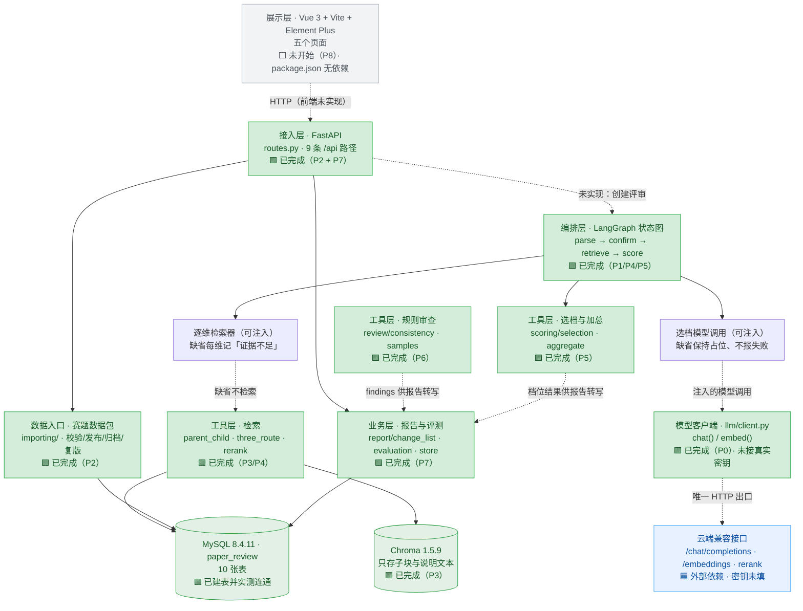

# paper-review 项目进度报告

> **生成时间**：2026-10-15 20:15
> **代码目录**：`D:\LEARN\AI\programs\AgentTask\Projects\paper-review`
> **解释器**：`D:\LEARN\AI\programs\AgentTask\env\agent-task\Scripts\python.exe`（Python 3.11.16）
> **数据来源**：全部为**实测**——`pytest` 实跑、`TestClient` 实捕获、SQL 实查、`--collect-only` 实计、全局 grep 实查；未使用推测值。
> **判定口径**：项目规矩是「`pytest` 退出码为 0 才写「通过」」（任务文档 §3.2）。本报告严格按此口径，**代码写完但测试未过 = 未通过**。
> **上一版**：`项目进度报告V1.md`（2026-10-15 18:20，当时 v0.5.0 未收口）。本版覆盖从 V1 之后完成的 P4 收口、P5、P6、P7 四段工作。

---

## 0. 现状摘要

| 里程碑 | 阶段 | 状态 | 关键判据 |
|---|---|---|---|
| v0.1.0 | P0 地基 | ✅ **通过** | `22 passed`，退出码 0 |
| v0.2.0 | P1 解析暂停 | ✅ **通过** | `11 passed`，退出码 0 |
| v0.3.0 | P2 赛题数据 | ✅ **通过** | `14 passed`，退出码 0，实连真 MySQL |
| v0.4.0 | P3 父子块检索 | ✅ **通过** | `14 passed`，退出码 0，真 Chroma + 真 MySQL |
| v0.5.0 | P4 重排与再检索 | ✅ **通过** | `13 passed`，退出码 0（**曾以 v0.5.1 补丁收口**） |
| v0.6.0 | P5 选档与加总 | ✅ **通过** | `17 passed`，退出码 0，`score/selection.py` 174 行 |
| v0.7.0 | P6 规则审查与样例 | ✅ **通过** | `13 passed`，退出码 0，三篇演示稿 + 12 篇评测样例落盘 |
| v0.8.0 | P7 报告与评测 | ✅ **通过** | `13 passed`，退出码 0，`report/` 六个模块 812 行 |
| v0.9.0 | P8 页面 | ⬜ 未开始 | `frontend/` 全部为 5～6 行注释壳，`package.json` 无任何依赖 |
| v1.0.0 | 总验收 | ⬜ 未开始 | — |

**一句话**：后端全链路（模型客户端 → 赛题入库 → 父子块检索 → 选档加总 → 规则审查 → 报告评测）已打通并**逐版以退出码 0 验证**；**前端为零**；剩余 P8 与首期总验收。另有两项待办：库内赛题仍为 `draft`（总验收要求三道为 `published`）、`LLM_*` 密钥未填（评测数字目前来自确定性回退，非模型）。

---

## 一、已实现的可验证内容清单

### 1.1 逐项验证台账

| # | 可验证内容 | 验证步骤 | 所需环境 | 判定标准 |
|---|:-:|:-:|---|---|
| 1 | **模型客户端契约**：`chat()` / `embed()` 只读约定字段，缺字段抛错而不返回空串 | `python -m pytest backend/tests/llm/test_client.py -q` | 解释器 `agent-task`；**无需网络**（`httpx.MockTransport` 注入） | 退出码 0；`LLMConfigError` / `LLMResponseError` 分场景抛出；除 `client.py` 外仓库内无第二处 HTTP 调用 |
| 2 | **章节确认与检查点**：未确认章节不进入评分；重启后从暂停点继续；空文档不产生 `review_id` | `python -m pytest backend/tests/graph/test_interrupt.py -q` | 无外部依赖（`InMemorySaver`，进程内） | 退出码 0；未 resume 时 `score_node_calls == 0`；同 `review_id` 重建图后仍停在 `("confirm",)` 且章节树不重算；空文本抛 `EmptyPaperError` |
| 3 | **赛题数据包导入与生命周期**：整包校验、发布、归档、复制下一版量规 | `python -m pytest backend/tests/importing/test_catalog.py -q` | **真实 MySQL**（读 `.env` 的 `MYSQL_DSN`） | 退出码 0；坏包返回 400 且带 `filename`/`field`；**不部分写入**；`archived` 不出现在默认列表；`fixture-extra` 走同一导入函数 |
| 4 | **父子块过滤检索**：先按 `contest_id`/`rubric_id`/`section_type` 过滤子块，再按 `parent_id` 取 MySQL 父块 | `python -m pytest backend/tests/retrieve/test_parent_child.py -q` | **真实 chromadb 1.5.9**（临时目录 `PersistentClient` + 自定义假 EmbeddingFunction，不下载模型）+ **真实 MySQL** | 退出码 0；错赛题子块 **0 条**；父块正文**不在** Chroma 的 `document` 字段；一张表一个块；`doc_type` 五值白名单强校验 |
| 5 | **重排与再检索**：三路各自召回 → 合并去重 → 一次重排 → 截断到 **总共 4 段**；两轮检索次数**恰为 2** | `python -m pytest backend/tests/retrieve/test_rerank_cap.py -q` | 内存假件为主（假向量存储 + 内存父块仓储 + 假重排客户端） | 退出码 0；重排前后 id 集合相等、加不回被过滤片段；父块数 ≤ 4；两轮空则该维「证据不足」且调用次数 = 2 |
| 6 | **选档与加权加总**：模型 JSON 只采纳 `band`/`chunk_id`/`quote`；权重只读量规 | `python -m pytest backend/tests/scoring/test_quote_and_weight.py -q` | 假 `chat` 注入，**不访问网络** | 退出码 0；`quote` 非连续子串 → 「引用失败」不加权；「证据不足」不加权；JSON 两次解析失败 → 总 `chat` 调用恰为 2；改模型返回里的 `weight` 合计不变 |
| 7 | **规则审查与三篇演示样例**：数字冲突、引用缺失、越界、缺少情形、未提到条件 | `python -m pytest backend/tests/review/test_demo_conflicts.py -q` | 无外部依赖；直接读 `data/samples/*.md` | 退出码 0；板凳龙报出 412 s / 386 s（偏移不同）；烟幕报出 22.4 s / 18.6 s、引用 `[12]` 缺失、160 m/s 越界；种植报出 1286 万元 / 974 万元、豆类约束缺失、`result1_2` 缺失；**反向断言**：300 m/s 与 1.5 s / 3.6 s / 20 s 不误报 |
| 8 | **报告与评测**：修改清单只转写已校验结果，顺序为题目约束与数字冲突 → 证据不足 → 表述 | `python -m pytest backend/tests/report/test_report_and_eval.py -q` | 真实 MySQL（评审两张表） | 退出码 0；第一条属于题目约束或数字冲突；缺上游 id 条数为 0；删上游记录后对应建议消失；奖项字样正则拒绝；旧评审 `rubric_version` 不被新发布改写 |
| 9 | **跨版回归** | `python -m pytest backend/tests -q` | 同上合集 | **`117 passed in 4.64s`**，退出码 0 |
| 10 | **五张 archify 图可交付** | `archify check <file> --json` | `D:\.skills\archify` | 五张 `.html` 均存在（约 0.81～0.83 MB）：`runtime.architecture`、`review.workflow`、`review.lifecycle`、`retrieve.sequence`、`chunks.dataflow`（各含 `.json` 源 + `.html` 成品） |
| 11 | **服务可启动** | `python -m uvicorn backend.app.api.app:app --host 127.0.0.1 --port 8077` | 上述环境 | 启动日志出现 `Application startup complete`；`GET /api/contests` 返回 **HTTP 200** `{"contests": []}` |
| 12 | **数据库表可建** | `create_schema()` / `create_parent_schema()` / `create_report_schema()` | 真实 MySQL | `paper_review` 库内 **10 张表**：`contest`、`constraint`、`rubric_template`、`rubric`、`dimension`、`pitfall`、`exemplar`、`paper_parent`、`review`、`review_dimension` |
| 13 | **数据资产合规** | 人工核对 + `load_eval_papers()` 读入 | 无 | 赛题 JSON **20 个**（4 题 × 5 文件：3 道公开赛题 + 第四道自建 `fixture-extra`）；演示稿 **3 篇**；评测样例 **12 篇** md + 12 篇同名 json，`gold` 覆盖五维、`expected_findings` 齐备；12 篇正文内**不含** 412/386/1286/974/22.4/18.6/160 等验收构造数字 |

### 1.2 已交付的代码资产

源码共 **29 个 Python 文件**，按模块列主要文件：

| 模块 | 文件 | 行数 | 状态 |
|---|---|---|---|
| 模型客户端 | `backend/app/llm/client.py` | 137 | ✅ 完成，**未接真实密钥** |
| 编排层 | `backend/app/graph/review_graph.py` | 537 | ✅ 完成（parse → confirm → retrieve → score → END） |
| 赛题导入 | `backend/app/importing/catalog.py` | 690 | ✅ 完成 |
| 导入模型 | `backend/app/importing/models.py` | 110 | ✅ 完成 |
| 数据库连接 | `backend/app/importing/db.py` | 75 | ✅ 完成（唯一连接串读取处） |
| 接入层路由 | `backend/app/api/routes.py` | 135 | ✅ 完成（**9 条路径**） |
| 应用装配 | `backend/app/api/app.py` | 20 | ✅ 完成 |
| 检索主链路 | `backend/app/retrieve/parent_child.py` | 491 | ✅ 完成 |
| 三路合并与两轮上限 | `backend/app/retrieve/three_route.py` | 179 | ✅ 完成 |
| 重排 | `backend/app/retrieve/rerank.py` | 84 | ✅ 完成（接口 + 假客户端；真实 HTTP 待授权后补） |
| 父块模型 | `backend/app/retrieve/models.py` | 38 | ✅ 完成（独立 `ParentBase`） |
| 选档 | `backend/app/scoring/selection.py` | 174 | ✅ 完成 |
| 加权加总 | `backend/app/scoring/aggregate.py` | 110 | ✅ 完成（纯函数） |
| 规则审查 | `backend/app/review/consistency.py` | 417 | ✅ 完成（五类 `kind`） |
| 样例读入 | `backend/app/review/samples.py` | 69 | ✅ 完成 |
| 评测汇总 | `backend/app/report/evaluation.py` | 307 | ✅ 完成 |
| 修改清单 | `backend/app/report/change_list.py` | 193 | ✅ 完成 |
| 评审持久化 | `backend/app/report/store.py` | 141 | ✅ 完成 |
| 报告模型 | `backend/app/report/models.py` | 60 | ✅ 完成（独立 `ReportBase`） |

**测试资产**：`backend/tests/` 共 **8 个测试文件，全部已有实现**，全量 **117 项**、**117 通过**；各文件用例数为 `pytest --collect-only` 实测值。

| 测试文件 | 行数 | 对应用例数 |
|---|---|---|
| `tests/llm/test_client.py` | 270 | 22 |
| `tests/graph/test_interrupt.py` | 261 | 11 |
| `tests/importing/test_catalog.py` | 416 | 14 |
| `tests/retrieve/test_parent_child.py` | 536 | 14 |
| `tests/retrieve/test_rerank_cap.py` | 481 | 13 |
| `tests/scoring/test_quote_and_weight.py` | 504 | 17 |
| `tests/review/test_demo_conflicts.py` | 306 | 13 |
| `tests/report/test_report_and_eval.py` | 421 | 13 |

### 1.3 已收口的遗留问题与仍需关注项

**（a）已收口：v0.5.0 的半成品状态**

V1 记录的「v0.5.0 代码已写、测试 1 项失败、台账未记」已收口：

- **根因**：`create_review()` 的初始状态字典预置了 `score_node_calls: 0` 与 `parse_node_calls: 0`，**漏了 P4 新增的 `retrieve_node_calls: 0`**；图停在 `confirm` 时该键从未写入，严格取值抛 `KeyError`。
- **修复**：补上缺失的初值一行（`review_graph.py:338` 附近），**测试未改动**，严格断言 `== 0` 保留。
- **台账**：`progress.md` 现同时有 `## v0.5.0`（状态：未通过，由 v0.5.1 收口）与 `## v0.5.1`（状态：通过），如实保留失败史。

**（b）仍需关注：库内数据尚未达到总验收要求**

SQL 实查结果（`paper_review`）：

| 表 | 行数 |
|---|---|
| `contest` | **1**（`cumcm-2024-A`，状态 `draft`） |
| `rubric` | 1（v1，`draft`） |
| `dimension` / `constraint` / `pitfall` / `exemplar` | 5 / 5 / 5 / 4 |
| `paper_parent` / `review` / `review_dimension` | 0 / 0 / 0 |

需求第十二章要求「可以选择 2024 年 A 题、2024 年 C 题、2025 年 A 题」，即三道赛题应为 `published`。当前库里只有一道 `draft` 赛题——**属数据装载事项，不是代码缺陷**，但会直接卡住 v1.0.0 总验收。

**（c）仍需关注：评测数字的来源**

`.env` 的四个模型键（`LLM_BASE_URL`/`LLM_API_KEY`/`LLM_MODEL`/`EMBEDDING_MODEL`）全为空，`/api/eval/summary` 返回的 `source = "deterministic"`，三项指标由**确定性结构回退**产出。其响应体里已自带说明：*「source=deterministic 时这些数字是确定性结构回退的脚本自检，不是模型准确率」*。要真实数字需注入 `chat`。

**（d）小瑕疵：接口文档版本号未随进度更新**

`backend/app/api/app.py` 里 `FastAPI(title="paper-review 预审接口", version="0.3.0")` 为字面量。实测 `/openapi.json` 的 `info.version` 仍是 `0.3.0`，与实际进度（已到 v0.8.0）不符。不影响功能，属对外文档的一致性问题。

---

## 二、当前可测试的接口列表（Postman）

### 2.1 前置条件

| 项 | 内容 |
|---|---|
| 启动命令 | `cd /d D:\LEARN\AI\programs\AgentTask\Projects\paper-review`<br>`& D:\LEARN\AI\programs\AgentTask\env\agent-task\Scripts\python.exe -m uvicorn backend.app.api.app:app --host 127.0.0.1 --port 8077` |
| Base URL | `http://127.0.0.1:8077` |
| 建表 | 首次运行需依次执行 `create_schema()`（赛题七张）、`create_parent_schema()`（`paper_parent`）、`create_report_schema()`（`review` / `review_dimension`）。应用启动**不会**隐式改库 |
| 依赖环境变量 | `.env` 的 `MYSQL_DSN`（**已配置并实测连通**，MySQL 8.4.11 / 库 `paper_review`）；`LLM_*` 四键**为空**，故评测走确定性回退 |
| 鉴权 | **无**。全部接口无 Token、无 Cookie、无 ApiKey |
| 互通格式 | 请求与响应均为 `application/json; charset=utf-8` |

### 2.2 接口清单

| 方法 | URL | 请求头 | 请求参数 / 请求体 | 预期状态码 | 响应示例 |
|---|---|---|---|---|---|
| `GET` | `/api/contests` | 无（可省） | Query（均可选）：`include_archived=false`、`include_drafts=false` | **200** | 默认只返回 `published`：`{"contests": []}`；带 `include_drafts=true` 时返回 `[{"contest_id":"cumcm-2024-A","year":2024,"problem_code":"A","title":"…","statement":"…","status":"draft"}]` |
| `POST` | `/api/imports` | `Content-Type: application/json` | Body：`{"package_dir": "data/contests/cumcm-2024-A"}`（相对路径按项目根解析） | **200**/400/422 | 成功：`{"contest_id":"cumcm-2024-A","rubric_id":1,"version":1,"dimensions":5,"constraints":5,"pitfalls":N,"exemplars":N}` |
| `POST` | `/api/contests/{contest_id}/publish` | 无 | 路径参数：`contest_id` | **200**/404 | `{"contest_id":"cumcm-2024-A","status":"published","rubric_id":1,"rubric_version":1}` |
| `POST` | `/api/contests/{contest_id}/archive` | 无 | 路径参数：`contest_id` | **200**/404 | `{"contest_id":"cumcm-2024-A","status":"archived"}` |
| `POST` | `/api/contests/{contest_id}/rubrics` | 无 | 路径参数：`contest_id` | **200**/404/**409** | `{"contest_id":"cumcm-2024-A","rubric_id":2,"version":2,"status":"draft"}` |
| `POST` | `/api/rubrics/{rubric_id}/publish` | 无 | 路径参数：`rubric_id` | **200**/404 | `{"contest_id":"cumcm-2024-A","rubric_id":2,"version":2,"status":"published","archived_rubric_ids":[1]}` |
| `GET` | `/api/samples` | 无（可省） | Query（可选）：`is_demo=true`/`false` | **200**/422 | 不筛：`{"samples":[…15 条…]}`；`is_demo=true` → 3 条演示稿；`is_demo=false` → 12 条评测样例。每条含 `sample_id`、`title`、`is_demo`、`contest_id`、`has_gold` |
| `GET` | `/api/eval/summary` | 无 | 无 | **200** | 见 2.3 的完整实测原文（含三项指标、`caliber` 口径、`source` 来源） |
| `GET` | `/api/reviews/{review_id}` | 无 | 路径参数：`review_id` | **200**/404 | 命中：评审记录（赛题编号、`rubric_version`、每维档位 / 切片编号 / 原句）；未命中：`{"detail":"找不到评审记录 <id>"}` |
| `GET` | `/openapi.json` | 无 | 无 | **200** | FastAPI 自动生成的 OpenAPI 3.1.0，**`paths` 共 9 条**；`info.title` = `paper-review 预审接口`，`info.version` = `0.3.0`（⚠️ 字面量未随进度更新） |
| `GET` | `/docs` | 无 | 无 | **200** | Swagger UI（HTML）。⚠️ 样式与脚本走 CDN，**离线打不开外观** |

### 2.3 已实测捕获的响应原文（可直接作为 Postman 断言基线）

**正常响应（实测原文）**

```json
GET /api/contests  →  200
{"contests": []}

GET /api/contests?include_archived=true&include_drafts=true  →  200
{"contests": [{"contest_id":"cumcm-2024-A","year":2024,"problem_code":"A",
               "title":"“板凳龙”闹元宵","statement":"…","status":"draft"}]}

GET /api/samples?is_demo=true  →  200
{"samples":[{"sample_id":"bench-dragon","title":"“板凳龙”闹元宵运动分析",
             "is_demo":true,"contest_id":"","has_gold":false},
            {"sample_id":"planting",  …},
            {"sample_id":"smoke",     …}]}

GET /api/eval/summary  →  200
{"corpus_papers":15,"gradable_papers":12,"gradable_dimensions":60,
 "source":"deterministic",
 "band_agreement":{"matched":26,"total":60,"rate":0.4333…,
   "caliber":"档位一致率 = 系统档位与 gold 档位一致的维度数 / 有 gold 的维度总数"},
 "quote_exact_match":{"matched":60,"total":60,"rate":1.0,
   "caliber":"引用精确匹配率 = 原句逐字出现在所引父块里的维度数 / 给出原句的维度数"},
 "insufficient_evidence_hit":{"matched":0,"total":2,"rate":0.0,
   "caliber":"证据不足命中情况 = gold 为证据不足且系统也判证据不足的维度数 / gold 为证据不足的维度数"},
 "no_samples":false,"demo_papers_without_gold":3,
 "note":"分子分母都按有 gold 的可算样本计算；三篇演示稿没有 gold，不计入分母。
         source=deterministic 时这些数字是确定性结构回退的脚本自检，不是模型准确率。"}
```

**错误响应（实测原文，非手写）**

| 场景 | 请求 | 状态码 | 实测响应体 |
|---|---|---|---|
| 数据包目录不存在 | `POST /api/imports`<br>`{"package_dir":"data/contests/does-not-exist"}` | **400** | `{"filename":"contest.json","field":"-","detail":"contest.json 的 -：数据包目录不存在：D:\\…\\data\\contests\\does-not-exist"}` |
| 目录存在但不是赛题包 | `POST /api/imports`<br>`{"package_dir":"data/samples"}` | **400** | `{"filename":"contest.json","field":"-","detail":"contest.json 的 -：数据包缺少 contest.json"}` |
| 缺必填字段 | `POST /api/imports`<br>`{"wrong":"x"}` | **422** | `{"detail":[{"type":"missing","loc":["body","package_dir"],"msg":"Field required","input":{"wrong":"x"}}]}` |
| 查询参数非法布尔 | `GET /api/samples?is_demo=abc` | **422** | `{"detail":[{"type":"bool_parsing","loc":["query","is_demo"],"msg":"Input should be a valid boolean, unable to interpret input","input":"abc"}]}` |
| 赛题不存在 | `POST /api/contests/not-exist/publish` | **404** | `{"detail":"找不到赛题 not-exist"}` |
| 赛题不存在 | `POST /api/contests/not-exist/archive` | **404** | `{"detail":"找不到赛题 not-exist"}` |
| 赛题不存在 | `POST /api/contests/not-exist/rubrics` | **404** | `{"detail":"找不到赛题 not-exist"}` |
| 量规不存在 | `POST /api/rubrics/999999/publish` | **404** | `{"detail":"找不到量规 999999"}` |
| 评审记录不存在 | `GET /api/reviews/not-exist` | **404** | `{"detail":"找不到评审记录 not-exist"}` |
| **被冻结掉的旧导入路径** | `POST /api/catalog/imports` | **404** | `{"detail":"Not Found"}` ✅ 证明裁决生效：只有 `/api/imports`，没有第二个导入路径 |

### 2.4 接口层的已知边界

| 边界 | 说明 |
|---|---|
| **无 `POST /api/reviews`** | 创建评审未实现；读接口 `GET /api/reviews/{id}` 已可用，但库里 `review` 表为 0 行，暂无数据可读 |
| **无 `POST /api/reviews/{review_id}/resume`** | 确认章节树后继续的 HTTP 入口未实现（图层面 `Command(resume)` 已通过测试） |
| **不支持文件上传** | `POST /api/imports` 只接受服务器本地路径字符串；上传论文属后续版本 |
| 无健康检查 | 没有 `/health`、`/readyz` 之类探针端点 |
| `include_archived` / `include_drafts` | 属实现层扩展参数，**已冻结的接口清单（任务文档 §4.4）里没有**；使用前建议同步更新该节 |
| OpenAPI 版本号 | `/openapi.json` 的 `info.version` 是 `app.py` 里的字面量 `0.3.0`，非项目正式交付物按 P7 后补的计划也未落地 |

---

## 三、项目整体架构图与核心流程图

> 说明：以下两张为**进度标注版**，用颜色区分完成度。项目另有五张 archify 产出的**可交互**架构图（`docs/diagrams/*.html`），那才是正式交付物；本节两张图仅为进度可视化，不替代它们。
>
> 图例：🟩 已完成（测试退出码 0）｜🟨 进行中/部分｜⬜ 未开始｜🟦 外部依赖

### 3.1 整体架构图（含完成度标注）



### 3.2 核心流程图（预审主路径 · 含完成度标注）


### 3.3 逐步完成度对照

| 步骤 | 实现位置 | 状态 | 依据 |
|---|---|---|---|
| ① 选择赛题 | `GET /api/contests` | 🟩 已完成 | 接口实测 200；默认只返回 `published`。⚠️ 库里仅 1 道 `draft`，尚无 `published` |
| ② 上传论文 / 填入样例 | `GET /api/samples` + 样例文件 | 🟨 部分 | 样例列表接口与 15 篇样例已就位；**创建评审接口 `POST /api/reviews` 未实现**，上传论文未实现 |
| ③ 解析章节树 | `graph/_parse_node`（ATX 标题规则） | 🟩 已完成 | `test_interrupt.py` 11 项通过 |
| ④ 人工确认章节 | `interrupt()` / `Command(resume)` | 🟨 部分 | 引擎已完成（含按 `review_id` 的检查点）；**HTTP 入口 `POST /api/reviews/{id}/resume` 未实现** |
| ⑤ 赛题对齐 | `constraint` 数据 + 对齐逻辑 | 🟨 部分 | 三种 `check_type` 已被审查与选档降档守卫消费；**图中尚无独立「对齐」节点，错题即停未落地** |
| ⑥ 逐维检索取证 | `retrieve/three_route.py`、`parent_child.py` | 🟩 已完成 | P3、P4 均通过；每维 ≤ 4 段、两轮上限恰为 2 |
| ⑦ 选档 | `scoring/selection.py` + 注入的 `chat` | 🟩 已完成 | `test_quote_and_weight.py` 17 项通过；模型只给 `band`/`chunk_id`/`quote` |
| ⑧ 规则审查 | `review/consistency.py` | 🟩 已完成 | 五类 `kind`；三篇演示必现冲突逐条报出 |
| ⑨ 原句子串校验 | `selection.quote_is_substring` | 🟩 已完成 | 非连续子串 → 「引用失败」不加权 |
| ⑩ 加权加总 | `scoring/aggregate.weighted_sum()` | 🟩 已完成 | 权重只读量规；证据不足与引用失败不进合计 |
| ⑪ 修改清单 | `report/change_list.py` | 🟩 已完成 | 排序为题目约束与数字冲突 → 证据不足 → 表述；每条带上游 id |

### 3.4 与 archify 正式图的对应

| archify 图 | 文件 | 覆盖的架构部分 | 交付状态 |
|---|---|---|---|
| 运行时架构 | `docs/diagrams/runtime.architecture.html` | 上图 3.1 | ✅ 已交付（832,655 B） |
| 预审主路径 | `docs/diagrams/review.workflow.html` | 上图 3.2 | ✅ 已交付（819,513 B） |
| 一维检索时序 | `docs/diagrams/retrieve.sequence.html` | 3.1 中「检索」分支 | ✅ 已交付（823,277 B） |
| 父子块数据流 | `docs/diagrams/chunks.dataflow.html` | 子块→Chroma / 父块→MySQL | ✅ 已交付（816,792 B） |
| 评审单状态机 | `docs/diagrams/review.lifecycle.html` | 五状态：草稿解析/待确认/评分中/完成/失败 | ✅ 已交付（811,119 B） |

---

## 四、可观测性现状评估

### 4.1 总评

> **结论：可观测性基础设施仍为零。** 除 `uvicorn` 自带的访问日志外，应用层**没有任何**日志、监控、指标、链路追踪或健康检查。本轮复核（P4～P7 完成后）与 V1 时点**结论一致，无改善**。
> 这一状态与当前阶段**基本匹配**（首期尚未进入运行期），但执行手册第 23 节要求记录的观测项**一项都没落地**——**风险已记账，见 4.5**。

### 4.2 逐项评估

| 能力 | 是否具备 | 实测证据 | 缺口 |
|---|---|---|---|
| **应用日志** | ❌ **无** | 全局 grep `backend/app/` 下 `import logging` / `logging.` / `logger` / `print(` → **0 处命中** | 无业务日志、无结构化日志、无日志级别控制、无日志落盘 |
| **访问日志** | 🟡 **有（框架自带）** | `uvicorn` 默认输出：`INFO: 127.0.0.1:57671 - "GET /api/contests HTTP/1.1" 200 OK` | 仅有状态码与路径，**无耗时、无请求体、无 `review_id` 关联**；进程重启即丢 |
| **监控** | ❌ 无 | 无 Prometheus / 无 `/metrics` / 无任何 exporter（grep 命中 0） | 完全空白 |
| **指标** | ❌ 无 | 无 `Gauge` / `Counter` / `Histogram` | 执行手册要求「每维检索条数、重排前后顺序、引用校验结果、模型耗时」**全部未实现** |
| **链路追踪** | ❌ 无 | 无 OpenTelemetry / 无 trace_id / 无 span（grep 命中 0） | 无法串联「一次预审跨了哪些节点、卡在哪一步」 |
| **关联 ID** | 🟡 **部分** | `review_graph.py` 用 `uuid.uuid4().hex` 生成 `review_id`；P7 的 `GET /api/reviews/{id}` 可按键取记录 | `review_id` **未进响应头、未进访问日志**，仍无法从 HTTP 层直接追到内部 |
| **健康检查** | ❌ 无 | 无 `/health`、`/readyz`、无 `liveness` | `compose.yaml` 的服务**全部为空壳**，健康检查也无处挂 |
| **全局异常处理** | 🟡 **部分** | 无 `add_exception_handler`；错误映射靠 `routes.py` 内逐路由 `try/except` → 400 / 404 / 409，参数校验交给 FastAPI 默认 422 | 未捕获异常走 FastAPI 默认 500，**不落日志**，排查只能靠复现 |
| **错误响应结构** | 🟡 **部分** | 实测三种体例：坏包 `{"filename","field","detail"}`；业务错误 `{"detail":"…"}`；参数错误 `{"detail":[{…}]}` | 三种结构并存，前端需分别处理 |
| **敏感信息保护** | 🟩 **有** | `db.py` 明确「只传递连接串，不打印它」；`get_dsn()` 缺失时抛错且信息不含凭据；`.env` 已被 `.gitignore` 排除 | 良好；但这是"没有日志"的副作用，一旦加日志需重新确认 |
| **测试期可观测** | 🟩 **有** | `pytest` 输出 + `progress.md` + `findings.md` + `archify check` 回执 | 仅覆盖开发期，运行期无继承 |

### 4.3 当前唯一的"观测渠道"清单

| 渠道 | 位置 | 记录内容 | 局限 |
|---|---|---|---|
| `pytest` 输出 | 终端 | 用例数、通过/失败、末行摘要 | 需手工粘贴留档 |
| 版本进度 | `docs/plan/progress.md`（**205 行**） | 每版命令 + 退出码 + 末行 + 补充说明，含 v0.5.0 的失败史 | 记录完整（v0.1.0～v0.8.0 共 9 节） |
| 技术裁决 | `docs/plan/findings.md`（**50 行**） | **21 条 Ruling**（v0.1.0 起，实测计数） | 与进度文件已对齐 |
| 图交付回执 | `%TEMP%\archify-paper-review\` | 门禁结果、sha256 | 在仓库外，**未入库**，重启即失 |
| uvicorn 访问日志 | 标准输出 | 状态码 + 路径 | 无持久化 |
| 评测汇总接口 | `GET /api/eval/summary` | 三项指标 + 口径 + 来源标记 | 只覆盖离线评测，不反映运行期状态 |
| 本报告 | `docs/version/explain/项目进度报告V2.md` | 本次全量快照 | 手工生成，非自动 |

### 4.4 缺口按计划的对齐情况

| 执行手册要求（第 23 节 运行、运维与应急方案） | 现状 |
|---|---|
| Compose 四服务**分别健康检查** | ❌ `compose.yaml` 四个服务全为空 `{}`，**无可运行配置、无健康检查** |
| 记录**每维检索条数** | ❌ 无指标、无日志（检索层返回结构里带 `route_hits`，但只进内存状态，不落任何观测通道） |
| 记录**重排前后顺序** | ❌ 无；`rerank` 只改变了顺序，未记录前后对照 |
| 记录**引用校验结果** | 🟨 有结果（`quote_is_substring`），但只体现在档位状态里，不进日志/指标 |
| 记录**模型耗时** | ❌ 无；`llm/client.py` 未记耗时 |
| 模型/重排不可用时**已确认章节树与审查结果仍可查看** | 🟨 章节树仍靠 `InMemorySaver` 存在**进程内存**中，**进程重启即丢**；审查结果可由 `review` 表落库，但该表当前 0 行 |
| 误发布量规通过**归档停用、不覆盖旧评审** | 🟩 已实现（`publish_rubric` 会归档旧版并返回 `archived_rubric_ids`；P7 用例另证旧评审 `rubric_version` 不被改写） |

### 4.5 建议（不属当前版本范围，供排期参考）

| 优先级 | 建议 | 落点建议 |
|---|---|---|
| 高 | 把 `review_id` 写进响应头与访问日志，让 HTTP 层能追到内部 | 摘要层中间件 |
| 高 | 加全局异常处理器 + 统一错误响应结构（消除现有三种体例） | `backend/app/api/` |
| 高 | 章节树检查点从 `InMemorySaver` 换成持久化（`review` / `review_dimension` 已在 MySQL，可一并落库） | P8 或总验收前 |
| 中 | 每维检索加结构化日志：维度、召回条数、`route_hits`、是否触发第二轮 | 检索层 |
| 中 | `llm/client.py` 记录模型耗时与重试次数（**不得记录密钥**） | 客户端内部 |
| 中 | 加 `/health`，并把 `compose.yaml` 的四服务补成可运行配置 | P8 前 |
| 中 | 把 `app.py` 里写死的 `version="0.3.0"` 改为可配置或随版本更新 | `backend/app/api/app.py` |
| 低 | 引入指标端点（`/metrics`）与链路追踪 | 二期 |
| 低 | 把 `%TEMP%` 下的 archify 回执复制进 `docs/diagrams/` | 随手可做 |

---

## 附：本报告的核对命令

```text
cd /d D:\LEARN\AI\programs\AgentTask\Projects\paper-review

# 1. 全量测试（当前预期：117 passed）
& D:\LEARN\AI\programs\AgentTask\env\agent-task\Scripts\python.exe -m pytest backend/tests -q

# 2. 逐版核对
& D:\LEARN\AI\programs\AgentTask\env\agent-task\Scripts\python.exe -m pytest backend/tests/llm/test_client.py -q
& D:\LEARN\AI\programs\AgentTask\env\agent-task\Scripts\python.exe -m pytest backend/tests/graph/test_interrupt.py -q
& D:\LEARN\AI\programs\AgentTask\env\agent-task\Scripts\python.exe -m pytest backend/tests/importing/test_catalog.py -q
& D:\LEARN\AI\programs\AgentTask\env\agent-task\Scripts\python.exe -m pytest backend/tests/retrieve/test_parent_child.py -q
& D:\LEARN\AI\programs\AgentTask\env\agent-task\Scripts\python.exe -m pytest backend/tests/retrieve/test_rerank_cap.py -q
& D:\LEARN\AI\programs\AgentTask\env\agent-task\Scripts\python.exe -m pytest backend/tests/scoring/test_quote_and_weight.py -q
& D:\LEARN\AI\programs\AgentTask\env\agent-task\Scripts\python.exe -m pytest backend/tests/review/test_demo_conflicts.py -q
& D:\LEARN\AI\programs\AgentTask\env\agent-task\Scripts\python.exe -m pytest backend/tests/report/test_report_and_eval.py -q

# 3. 启动服务供 Postman 测试
& D:\LEARN\AI\programs\AgentTask\env\agent-task\Scripts\python.exe -m uvicorn backend.app.api.app:app --host 127.0.0.1 --port 8077

# 4. 建表（首次运行，三处各自的 metadata）
& D:\LEARN\AI\programs\AgentTask\env\agent-task\Scripts\python.exe -c "from backend.app.importing.db import create_schema; create_schema()"
& D:\LEARN\AI\programs\AgentTask\env\agent-task\Scripts\python.exe -c "from backend.app.retrieve.models import create_parent_schema; create_parent_schema()"
& D:\LEARN\AI\programs\AgentTask\env\agent-task\Scripts\python.exe -c "from backend.app.report.models import create_report_schema; create_report_schema()"
```
