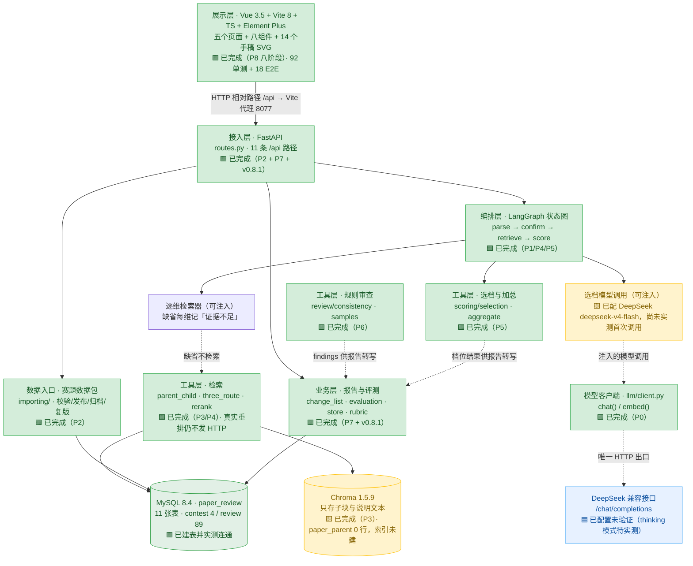

# paper-review 项目进度报告 V3

> **生成时间**：2026-10-17 14:25
> **代码目录**：`D:\LEARN\AI\programs\AgentTask\Projects\paper-review`
> **解释器**：`D:\LEARN\AI\programs\AgentTask\env\agent-task\Scripts\python.exe`（Python 3.11.16）
> **当前分支**：`v0.9.0-p8-frontend`（提交 `65c6449`）
> **数据来源**：全部为**实测**——四道门禁实跑、11 条接口实采、SQL 实查、Playwright 实测几何中心、全局 grep 实查；未使用推测值。
> **上一版**：`项目进度报告V2.md`（2026-10-15 20:15，当时 P8 未开始、库内仅 1 道 draft 赛题）。本版覆盖 P7 补完、P8 八阶段、手稿风格设计与修复。
> **判定口径**：项目规矩是「退出码为 0 才写『通过』」（任务文档 §3.2）。本报告严格按此口径。

---

## 0. 现状摘要

### 0.1 里程碑状态

| 里程碑 | 阶段 | 状态 | 关键判据 |
|---|---|---|---|
| v0.1.0 | P0 地基 | ✅ **通过** | `22 passed`，退出码 0 |
| v0.2.0 | P1 解析暂停 | ✅ **通过** | `11 passed`，退出码 0 |
| v0.3.0 | P2 赛题数据 | ✅ **通过** | `14 passed`，退出码 0，实连真 MySQL |
| v0.4.0 | P3 父子块检索 | ✅ **通过** | `14 passed`，退出码 0，真 Chroma + 真 MySQL |
| v0.5.0 | P4 重排与再检索 | ✅ **通过** | `13 passed`，退出码 0（**曾以 v0.5.1 补丁收口**） |
| v0.6.0 | P5 选档与加总 | ✅ **通过** | `17 passed`，退出码 0 |
| v0.7.0 | P6 规则审查与样例 | ✅ **通过** | `13 passed`，退出码 0 |
| v0.8.0 | P7 报告与评测 | ✅ **通过** | `13 passed`，退出码 0 |
| **v0.8.1** | P7 补完 | ✅ **通过** | **17 passed**（新增 15 个测试函数）；补齐两条排期空洞接口 |
| **v0.9.0** | P8 页面 | ✅ **通过** | **8 个阶段全过**：前端工程 + 五页 + 手稿风格 + 修复 |
| v1.0.0 | 总验收 | ⬜ 未开始 | 需求第十二章逐条验收，属文档版本 `v1.9.0` |

### 0.2 四道门禁（2026-10-17 14:22 实跑）

| 门禁 | 结果 |
|---|---|
| `npm run build`（含 `vue-tsc --noEmit`） | 退出码 **0**，✓ built in 6.82s（JS 1,047.90 kB / gzip 336.68 kB；CSS 394.96 kB / gzip 53.73 kB） |
| `npx vitest run` | **92 passed**（13 个 spec） |
| `npx playwright test` | **18 passed**（8 个 spec，真浏览器） |
| `pytest backend/tests -q` | **134 passed in 9.11s** |

### 0.3 一句话

**后端全链路 + 前端五个页面 + 手稿风格设计全部落地，四道门禁全绿**；三个原报告过的 bug（圈注跑位、评测折线图为静态图、修改建议页未手稿化）已由 v1.8.7 修复并有实测证据。剩余工作是：**接入真实模型跑一次评审**、补 5 个后端接口缺口、需求第十二章总验收。另有 `.env` 已配 DeepSeek（`deepseek-v4-flash`）但**尚未实测首次调用**。

---

## 一、已实现的可验证内容清单

### 1.1 逐项验证台账

| # | 可验证内容 | 验证步骤 | 所需环境 | 判定标准 |
|---|:-:|:-:|---|---|
| 1 | **模型客户端契约**：`chat()` / `embed()` 只读约定字段，缺字段抛错而不返回空串 | `pytest backend/tests/llm/test_client.py -q` | 解释器 `agent-task`；**无需网络**（`httpx.MockTransport` 注入） | 退出码 0；除 `client.py` 外仓库内无第二处 HTTP 调用 |
| 2 | **章节确认与检查点**：未确认不评分；重启后从暂停点继续；空文档不产生 `review_id` | `pytest backend/tests/graph/test_interrupt.py -q` | 无外部依赖 | 退出码 0；未 resume 时 `score_node_calls == 0`；二次 resume 不重算章节树 |
| 3 | **赛题数据包导入与生命周期**：整包校验、发布、归档、复制下一版量规 | `pytest backend/tests/importing/test_catalog.py -q` | **真实 MySQL** | 退出码 0；坏包 400 且带 `filename`/`field`；**不部分写入**；`archived` 不进默认列表 |
| 4 | **父子块过滤检索**：先过滤子块再取父块 | `pytest backend/tests/retrieve/test_parent_child.py -q` | **真 chromadb 1.5.9** + **真 MySQL** | 退出码 0；错赛题子块 **0 条**；父块正文**不在** Chroma `document` 字段 |
| 5 | **重排与再检索**：三路合并、4 段上限、两轮收敛 | `pytest backend/tests/retrieve/test_rerank_cap.py -q` | 内存假件为主 | 退出码 0；重排前后 id 集合相等；两轮空则该维「证据不足」且调用次数 = 2 |
| 6 | **选档与加权加总**：JSON 白名单、原句子串校验、权重只读量规 | `pytest backend/tests/scoring/test_quote_and_weight.py -q` | 假 `chat` 注入 | 退出码 0；`quote` 非子串 → 「引用失败」不加权；JSON 两次失败 → 总调用恰为 2 |
| 7 | **规则审查与三篇演示样例**：五类 `kind` | `pytest backend/tests/review/test_demo_conflicts.py -q` | 无外部依赖 | 退出码 0；板凳龙 412/386、烟幕 22.4/18.6 + 引用[12] + 160 m/s、种植 1286/974 万元 + 豆类 + `result1_2`；**反向断言**：300 m/s 与 1.5/3.6/20 s 不误报 |
| 8 | **报告与评测**：修改清单只转写已校验结果 | `pytest backend/tests/report/test_report_and_eval.py -q` | 真实 MySQL | 退出码 0；三段顺序固定；缺上游 id 条数为 0；旧评审 `rubric_version` 不被改写 |
| 9 | **评审创建与确认的 HTTP 入口**（v0.8.1 新增） | `pytest backend/tests/report/test_review_flow.py -q` | 真实 MySQL | 退出码 0；`POST /api/reviews` 201；`paper_text` 与 `sample_id` 互斥（400）；空论文拒绝（400）；坏 sample_id 400；resume 后 5 维齐备 |
| 10 | **跨版回归** | `pytest backend/tests -q` | 同上合集 | **`134 passed in 9.11s`**，退出码 0 |
| 11 | **前端工程与门禁体系** | `npm run build` + `npx vitest run` + `npx playwright test` | Node v22.22.2 / npm 10.9.7 | build 0 / **92 passed** / **18 passed** |
| 12 | **五页可填入示例并走完整链路** | `npx playwright test tests/e2e/parse.spec.ts` | 真 MySQL + uvicorn + vite | 演示稿一键填入 → 章节树 → 确认 → 评分/审查/建议三页数据齐 |
| 13 | **未确认时下游页无结果** | `npx playwright test tests/e2e/smoke.spec.ts` | 同上 | 直接开 `/scoring` `/consistency` `/suggestions` 均显示空态且**不含档位词/审查词/建议词** |
| 14 | **圈注定位精度**（v1.8.7 新增） | `npx playwright test tests/e2e/sketch-fix.spec.ts` | 同上 | 评分页圈中心偏差 **0.85px**、审查页 **0.86px**（要求 ≤ 4px） |
| 15 | **评测折线按数据生成**（v1.8.7 新增） | 同上 | 同上 | 三条折线 path 互不相同（实测三条 d 值见 §1.3） |
| 16 | **两视口无横向滚动**（v1.8.7 新增） | `npx playwright test tests/e2e/visual.spec.ts` | 同上 | 1280×800 与 1920×1080 下五页 `scrollWidth <= innerWidth + 1` |
| 17 | **服务可启动 + 11 条接口可用** | `uvicorn ... --port 8077` 后逐条实采 | 真实 MySQL | 见 §2.4 实测原文 |
| 18 | **数据资产合规** | SQL 实查 + 人工核对 | 无 | 4 道赛题（3 published + 1 archived）；3 篇演示稿；12 篇评测样例 md + json |

### 1.2 已交付的代码资产

**后端**：39 个 Python 文件，9 个测试文件，**134 项用例**。

| 模块 | 主要文件 | 状态 |
|---|---|---|
| 模型客户端 | `llm/client.py` | ✅ 完成，**已配 DeepSeek 但未跑真实调用** |
| 编排层 | `graph/review_graph.py` | ✅ 完成（parse → confirm → retrieve → score） |
| 赛题导入 | `importing/catalog.py`、`models.py`、`db.py` | ✅ 完成 |
| 接入层 | `api/routes.py`、`api/app.py` | ✅ 完成（**11 条路径**） |
| 检索工具层 | `retrieve/parent_child.py`、`three_route.py`、`rerank.py`、`models.py` | ✅ 完成（真实重排仍不发 HTTP） |
| 选档与加总 | `scoring/selection.py`、`aggregate.py` | ✅ 完成 |
| 规则审查 | `review/consistency.py`、`samples.py` | ✅ 完成 |
| 报告与评测 | `report/change_list.py`、`evaluation.py`、`store.py`、`models.py`、`catalog.py`、**`rubric.py`** | ✅ 完成（rubric.py 为 v0.8.1 新增只读模块） |

**前端**：`frontend/src` 下 **38 个文件**，13 个单测 spec + 8 个 E2E spec，**92 + 18 项用例**。

| 层 | 文件 | 说明 |
|---|---|---|
| 入口 | `main.ts`、`App.vue`、`index.html` | Vue 3.5 + Element Plus + router |
| 路由 | `router/index.ts` | 7 条（`/` → `/parse`、`/parse`、`/scoring`、`/consistency`、`/suggestions`、`/eval`、`/eval/:paperId`） |
| 接口层 | `api/index.ts`（11 函数）、`api/types.ts` | URL 一律相对路径，非 2xx 抛 `ApiError` 带 `detail` |
| 页面 | `views/` 5 个中文名 `.vue` | 545 / 363 / 225 / 251 / 305 行 |
| 组件 | `components/` 8 个 | AppNav、SectionTree、SectionReader、StageTracker、DimensionCard、ConflictItem、SuggestionItem、MetricCard |
| 组合式 | `composables/` 4 个 | useReviewFlow、reviewVocabulary、reviewShape、useOffsetLocator |
| 样式 | `styles/tokens.css`（180 行）、`styles/sketch.css` | tokens 是唯一颜色来源；sketch 只做三件事（纸纹 / 三个复用类 / 绘制约定） |
| 资产 | `assets/sketch/` 14 个 SVG | 全部 `stroke="currentColor"`，原创手绘 |

**设计资产**：`docs/design/`（`sketch-style.md` 409 行 + 14 个 SVG + 样张 html/png + `frontend/shot-sketch.mjs` 截图工具）。

**文档资产**：

| 文档 | 规模 |
|---|---|
| `README.md` | 启动六步、四道门禁、挂账清单、11 条接口表 |
| `docs/version/explain/v1.0.0_前端功能说明.md` | 183 行，五页八组件功能说明（零代码痕迹） |
| `docs/version/explain/项目进度报告V1/V2/V3.md` | 三个时点的全量进度快照 |
| `docs/plan/progress.md` | **1528 行**，含 v0.5.0 失败史与 P8 八个阶段 |
| `docs/plan/findings.md` | **103 行**，40+ 条 Ruling |
| `docs/version/10.16/v1.7.2` + `v1.8.0`～`v1.8.7` | 9 份阶段提示词 |
| `docs/push_version/push_V1.md` / `push_V2.md` | 两版推送档案 |

### 1.3 已收口的遗留问题

**（a）v1.8.7 修复的三个 bug（有实测证据）**

| Bug | 根因 | 修复证据 |
|---|---|---|
| 手绘圈跑位 | `card__band-circle` 同时写 `inset` 与 `width/height`（互相覆盖）；`conflict__hit-circle` 依赖父级 `position: relative` 但没保证 | Playwright 实测圈中心偏差：评分页 **0.85px**、审查页 **0.86px**（要求 ≤ 4px） |
| 评测折线图是假的 | 三张卡 `import` 同一张静态 SVG | 三条 path 实测互不相同：<br>`band_agreement = M16 72 C 81 57 129 45 190 45.1`<br>`quote_exact_match = M16 72 C 81 28.2 129 16.2 190 10`<br>`insufficient_evidence_hit = M16 72 C 81 79 129 67 190 72` |
| 修改建议页未手稿化 | 五页里唯独该页是朴素卡片 | 已用同一套 `sk-card-frame` + 段间箭头 + 等宽编号 |

**（b）数据装载已完成（V2 时的卡点已解除）**

SQL 实查（`paper_review`）：

| 表 | 行数 | 说明 |
|---|---|---|
| `contest` | **4** | 3 道 `published` + 1 道 `archived`（`fixture-extra`） |
| `constraint` | 16 | 三道赛题合计 |
| `rubric` | 4 | 3 published + 1 archived |
| `dimension` | 20 | 3 题 × 5 维 + fixture 5 维 |
| `pitfall` / `exemplar` | 17 / 14 | |
| `paper_parent` | **0** | 尚未建索引（检索链路未接） |
| `review` | **89** | E2E 累积 |
| `review_dimension` | **435** | 89 × 5 维 − 少量未确认 |
| `review_session` | **95** | E2E 累积 |

需求 §12.1「可以选择 2024 年 A 题、2024 年 C 题、2025 年 A 题」**已满足**。

**（c）两条排期空洞接口已补齐（v0.8.1）**

执行手册 §3.6 冻结了 9 条路径，其中 `POST /api/reviews` 与 `POST /api/reviews/{id}/resume` 被冻结、被任务文档 §14 当"已有的"引用，却从未排期。v0.8.1 已补齐，并新增 `ReviewSession` 表与 `report/rubric.py`。

---

## 二、当前可测试的接口列表（Postman）

### 2.1 前置条件

| 项 | 内容 |
|---|---|
| 启动命令 | `cd /d D:\LEARN\AI\programs\AgentTask\Projects\paper-review`<br>`& D:\LEARN\AI\programs\AgentTask\env\agent-task\Scripts\python.exe -m uvicorn backend.app.api.app:app --host 127.0.0.1 --port 8077` |
| Base URL | `http://127.0.0.1:8077` |
| MySQL | 服务 `StartType=Manual`，开机不自启。先 `Start-Process "D:\MySQL\Server8.4\bin\mysqld.exe" -ArgumentList "--defaults-file=D:\MySQL\my.ini" -WindowStyle Hidden` |
| 建表 | 首次运行执行 `create_schema()` + `create_report_schema()`（幂等）。应用启动**不会**隐式改库 |
| 环境变量 | `.env` 的 `MYSQL_DSN` **已配置并实测连通**；`LLM_*` 已配 DeepSeek（`deepseek-v4-flash`），但选档当前走确定性回退 |
| 鉴权 | **无**。全部接口无 Token、无 Cookie、无 ApiKey |
| 互通格式 | 请求与响应均为 `application/json; charset=utf-8` |
| ⚠️ 代理 | 本机 curl 默认走代理，请求 127.0.0.1 要用 `--noproxy "*"`；Postman 需在 Settings 里关掉代理 |

### 2.2 接口清单（11 条 + 2 条文档端点）

| 方法 | URL | 请求体 / 参数 | 预期状态码 | 说明 |
|---|---|---|---|---|
| `GET` | `/api/contests` | Query 可选：`include_archived`、`include_drafts` | **200** | 默认只返回 `published` |
| `GET` | `/api/samples` | Query 可选：`is_demo=true/false` | **200**/422 | 15 条样例 |
| `GET` | `/api/eval/summary` | 无 | **200** | 三项评测指标 |
| `POST` | `/api/reviews` | `{"sample_id": "...", "contest_id": "..."}` 或 `{"paper_text": "...", "contest_id": "..."}` | **201**/400/422 | **v0.8.1 新增**。两个字段互斥 |
| `POST` | `/api/reviews/{review_id}/resume` | `{"sections": [...]}` | **200**/400/404 | **v0.8.1 新增**。确认章节树并出报告 |
| `GET` | `/api/reviews/{review_id}` | 路径参数 | **200**/404 | 已落档返回 7 字段存档；只有快照返回章节树 |
| `POST` | `/api/imports` | `{"package_dir": "data/contests/xxx"}` | **200**/400/422 | 整包校验 |
| `POST` | `/api/contests/{contest_id}/publish` | 路径参数 | **200**/404 | 发布赛题 |
| `POST` | `/api/contests/{contest_id}/archive` | 路径参数 | **200**/404 | 归档赛题 |
| `POST` | `/api/contests/{contest_id}/rubrics` | 路径参数 | **200**/404/**409** | 复制出 `version+1` 的 draft |
| `POST` | `/api/rubrics/{rubric_id}/publish` | 路径参数 | **200**/404 | 发布新版本量规 |
| `GET` | `/openapi.json` | 无 | **200** | OpenAPI 3.1.0，`paths` 共 11 条 |
| `GET` | `/docs` | 无 | **200** | Swagger UI（样式走 CDN，离线打不开外观） |

### 2.3 Postman 测试方法

#### 2.3.1 建 Collection 与环境变量

1. **New → Collection**，命名 `paper-review`。
2. **Variables** 页加两个变量：

| 变量 | Current Value |
|---|---|
| `base` | `http://127.0.0.1:8077` |
| `reviewId` | （留空，由测试脚本自动写入） |

3. 后续所有请求 URL 写成 `{{base}}/api/...`，换端口只改变量。

#### 2.3.2 逐接口的请求配置

| # | 请求名 | Method | URL | Body（raw → JSON） | 保存为变量的字段 |
|---|---|---|---|---|---|
| 1 | 赛题列表 | `GET` | `{{base}}/api/contests` | — | — |
| 2 | 样例列表 | `GET` | `{{base}}/api/samples` | — | — |
| 3 | 评测汇总 | `GET` | `{{base}}/api/eval/summary` | — | — |
| 4 | 创建评审 | `POST` | `{{base}}/api/reviews` | `{"sample_id":"bench-dragon","contest_id":"cumcm-2024-A"}` | `reviewId` ← `review_id` |
| 5 | 确认并出报告 | `POST` | `{{base}}/api/reviews/{{reviewId}}/resume` | 见下方说明 | — |
| 6 | 读评审存档 | `GET` | `{{base}}/api/reviews/{{reviewId}}` | — | — |
| 7 | 导入赛题 | `POST` | `{{base}}/api/imports` | `{"package_dir":"data/contests/cumcm-2024-A"}` | — |
| 8 | 发布赛题 | `POST` | `{{base}}/api/contests/cumcm-2024-A/publish` | — | — |
| 9 | 归档赛题 | `POST` | `{{base}}/api/contests/fixture-extra/archive` | — | — |
| 10 | 复制量规 | `POST` | `{{base}}/api/contests/cumcm-2024-A/rubrics` | — | — |
| 11 | 发布量规 | `POST` | `{{base}}/api/rubrics/{{rubricId}}/publish` | — | `rubricId` ← `rubric_id` |

**请求 5 的请求体怎么来**：`resume` 需要完整的 `sections` 数组。最省事的做法是在请求 4 的 **Tests** 脚本里把 `sections` 也存成环境变量：

```javascript
// 请求 4（创建评审）的 Tests 页签
pm.environment.set("reviewId", pm.response.json().review_id);
pm.environment.set("sections", pm.response.json().sections);
```

然后请求 5 的 Body 直接写：

```json
{ "sections": {{sections}} }
```

Postman 会把数组原样展开。改章节类型时，在日志里改 `sections` 再发即可。

#### 2.3.3 断言脚本（Tests 页签，可直接粘贴）

**请求 1 · 赛题列表**（验证默认只返回 published）：

```javascript
pm.test("状态码 200", () => pm.response.to.have.status(200));
const j = pm.response.json();
pm.test("恰好三道已发布赛题", () => pm.expect(j.contests).to.have.length(3));
pm.test("全部为 published", () =>
  j.contests.forEach(c => pm.expect(c.status).to.eql("published")));
pm.test("含硬性条件字段", () =>
  pm.expect(j.contests[0]).to.have.property("constraints"));
```

**请求 4 · 创建评审**：

```javascript
pm.test("状态码 201", () => pm.response.to.have.status(201));
const j = pm.response.json();
pm.test("返回 8 个章节", () => pm.expect(j.sections).to.have.length(8));
pm.test("状态为待确认", () => pm.expect(j.status).to.eql("待确认"));
pm.test("响应里没有任何档位字段", () =>
  pm.expect(j).to.not.have.property("dimensions"));
pm.environment.set("reviewId", j.review_id);
pm.environment.set("sections", j.sections);
```

**请求 5 · 确认并出报告**：

```javascript
pm.test("状态码 200", () => pm.response.to.have.status(200));
const j = pm.response.json();
pm.test("五个维度齐备", () => pm.expect(j.dimensions).to.have.length(5));
pm.test("每维都有 dimension_code 与 band", () =>
  j.dimensions.forEach(d => {
    pm.expect(d).to.have.property("dimension_code");
    pm.expect(d).to.have.property("band");
  }));
pm.test("确定性回退下加权为 0 且 source 标注清楚", () => {
  if (j.source === "deterministic") {
    pm.expect(j.score.weight_sum).to.eql(0);
    pm.expect(j.note).to.be.a("string");
  }
});
pm.test("修改清单第一条属于硬伤段", () => {
  if (j.change_list.length > 0) {
    pm.expect(j.change_list[0].section).to.eql("题目约束与数字冲突");
  }
});
```

**请求 3 · 评测汇总**：

```javascript
pm.test("状态码 200", () => pm.response.to.have.status(200));
const j = pm.response.json();
pm.test("三项指标都在", () => {
  ["band_agreement","quote_exact_match","insufficient_evidence_hit"]
    .forEach(k => pm.expect(j).to.have.property(k));
});
pm.test("每项都有 caliber 口径", () =>
  pm.expect(j.band_agreement.caliber).to.be.a("string").and.not.empty);
pm.test("确定性回退必须带说明", () => {
  if (j.source === "deterministic") pm.expect(j.note).to.include("不是模型准确率");
});
pm.test("分母为 0 时 rate 必须是 null", () => {
  Object.values(j).forEach(v => {
    if (v && typeof v === "object" && "rate" in v && v.total === 0) {
      pm.expect(v.rate).to.be.null;
    }
  });
});
```

#### 2.3.4 常见错误与排查

| 现象 | 原因 | 处理 |
|---|---|---|
| Postman 一直转圈 / `ECONNREFUSED` | 后端没起，或**走了系统代理** | Settings → Proxy → 关掉「Use system proxy」；确认 uvicorn 日志有 `Application startup complete` |
| `Connection refused` 但服务在跑 | MySQL 没起 | 见 §2.1 的 mysqld 拉起命令 |
| 请求 5 报 400 `paper_text 与 sample_id 只能给一个` | 请求 4 的 Body 两个字段都给了 | 只留一个 |
| 请求 5 报 400 `paper_text 为空或全是空白` | 请求 4 用了空 `paper_text` | 传非空白正文 |
| 请求 5 报 400 `找不到演示稿` | `sample_id` 写错 | 用 `GET /api/samples` 拿真实 `sample_id` |
| 请求 5 报 404 `找不到会话快照` | `reviewId` 变量没设上 | 重跑请求 4，看它的 Tests 是否通过 |
| 请求 6 只返回 7 个字段 | **正常行为**——已落档的存档不含 `score`/`change_list`/`note` | 要看全量报告用请求 5 的响应 |
| 请求 7 报 400 带 `filename`/`field` | 数据包校验失败 | 按返回的 `filename` 与 `field` 定位到具体 JSON |

### 2.4 已实测捕获的响应原文（2026-10-17 14:23 实采，可作为断言基线）

**正常响应**

```json
GET /api/contests → 200
{"contests": [
  {"contest_id":"cumcm-2024-A","year":2024,"problem_code":"A",
   "title":"“板凳龙”闹元宵","status":"published",
   "rubric":{"rubric_id":"cumcm-2024-A-v1","version":1,"status":"published"},
   "constraints":[{"constraint_id":"cumcm-2024-A-collision","name":"板凳之间不能相撞",
                   "check_type":"mention","params":{"keywords":["碰撞","相撞","板凳宽度"]},
                   "section_types":["假设","模型","求解","检验"]}, …],
   "pitfall_count":5,"exemplar_count":5},
  {"contest_id":"cumcm-2024-C", …}, {"contest_id":"cumcm-2025-A", …}
]}          ← 共 3 条，全部 published

GET /api/samples → 200
{"samples":[ … 15 条 … ]}     ← is_demo 3 条；has_gold 12 条

GET /api/eval/summary → 200
{"corpus_papers":15,"gradable_papers":12,"gradable_dimensions":60,
 "source":"deterministic",
 "band_agreement":{"matched":26,"total":60,"rate":0.4333…,
   "caliber":"档位一致率 = 系统档位与 gold 档位一致的维度数 / 有 gold 的维度总数"},
 "quote_exact_match":{"matched":60,"total":60,"rate":1.0, "caliber":"…"},
 "insufficient_evidence_hit":{"matched":0,"total":2,"rate":0.0, "caliber":"…"},
 "no_samples":false,"demo_papers_without_gold":3,
 "note":"分子分母都按有 gold 的可算样本计算；…source=deterministic 时这些数字是确定性结构回退的脚本自检，不是模型准确率。"}

POST /api/reviews → 201
{"review_id":"f79b9eadbbff401a8cafb3c4b017751f","status":"待确认",
 "sections":[ … 8 个章节 … ]}      ← 没有任何档位字段

POST /api/reviews/{id}/resume → 200
{"review_id":"…","status":"完成","contest_id":"cumcm-2024-A",
 "rubric_id":"cumcm-2024-A-v1","rubric_version":1,
 "model_name":"deterministic","source":"deterministic",
 "dimensions":[ … 5 维，每维 {dimension_code, band, chunk_ids, quote, status} … ],
 "score":{"total":0,"weighted":0,"excluded":[],"weight_sum":0},
 "change_list":[ … 3 条，第一条为「数字冲突 · 盘入终止时刻」… ],
 "note":null}

GET /api/reviews/{id} → 200（已落档）
{"review_id":"…","contest_id":"cumcm-2024-A","rubric_id":"cumcm-2024-A-v1",
 "rubric_version":1,"model_name":"deterministic","created_at":"…",
 "dimensions":[ … ]}      ← 只有 7 个字段，无 score/change_list/note
```

**错误响应（实测原文）**

| 场景 | 请求 | 状态码 | 实测响应体 |
|---|---|---|---|
| 评审记录不存在 | `GET /api/reviews/nope` | **404** | `{"detail":"找不到评审记录 nope"}` |
| 数据包目录不存在 | `POST /api/imports` `{"package_dir":"data/contests/does-not-exist"}` | **400** | `{"filename":"contest.json","field":"-","detail":"contest.json 的 -：数据包目录不存在：…"}` |
| 缺必填字段 | `POST /api/imports` `{"wrong":"x"}` | **422** | `{"detail":[{"type":"missing","loc":["body","package_dir"],"msg":"Field required","input":{"wrong":"x"}}]}` |
| 查询参数非法布尔 | `GET /api/samples?is_demo=abc` | **422** | `{"detail":[{"type":"bool_parsing","loc":["query","is_demo"],"msg":"Input should be a valid boolean…","input":"abc"}]}` |
| 赛题不存在 | `POST /api/contests/not-exist/publish` | **404** | `{"detail":"找不到赛题 not-exist"}` |
| 被冻结的旧导入路径 | `POST /api/catalog/imports` | **404** | `{"detail":"Not Found"}` ✅ 证明裁决生效 |

### 2.5 接口层的已知边界

| 边界 | 说明 |
|---|---|
| **无「取量规维度」接口** | 前端拿不到维度中文名、权重、四档说明，评分页只能显示 `dimension_code` |
| **无单篇评测接口** | `/eval/:paperId` 只能显示缺口说明 |
| **存档只有 7 字段** | `GET /api/reviews/{id}` 不含 `score`/`change_list`/`note`；审查结果不落库导致历史记录看不到审查清单 |
| **不支持文件上传** | 只收 Markdown 文本或 `sample_id` |
| 无健康检查 | 没有 `/health`、`/readyz` |
| `include_archived` / `include_drafts` | 属实现层扩展参数，任务文档 §4.4 的冻结清单里没有 |
| OpenAPI 版本号 | `/openapi.json` 的 `info.version` 是 `app.py` 里的字面量 `0.3.0`，与实际进度不符 |

---

## 三、项目整体架构图与核心流程图

> 图例：🟩 已完成（退出码 0）｜🟨 部分完成／待接入｜⬜ 未开始｜🟦 外部依赖
> 项目另有五张 archify 产出的**可交互**架构图（`docs/diagrams/*.html`），那才是正式交付物；本节三张图仅为进度可视化。

### 3.1 整体架构图（含完成度标注）



### 3.2 核心流程图（预审主路径 · 含完成度标注）


### 3.3 逐步完成度对照

| 步骤 | 实现位置 | 状态 | 依据 |
|---|---|---|---|
| ① 选择赛题 | `GET /api/contests` + 解析页下拉 | 🟩 已完成 | 实测 200 返回 3 道 published；未选题时提交按钮禁用 |
| ② 填入演示稿 / 粘贴正文 | 解析页 + `POST /api/reviews` | 🟩 已完成 | 3 篇演示一键填入；粘贴正文两条路互斥；实测 201 |
| ③ 解析章节树 | `graph/_parse_node` | 🟩 已完成 | 实测返回 8 个章节 |
| ④ 人工确认章节 | `interrupt()` / `Command(resume)` + `POST /resume` | 🟩 已完成 | 未确认时下游页全空态（E2E 验证） |
| ⑤ 逐维检索取证 | `retrieve/three_route.py` | 🟨 部分 | 代码完成并测试通过；但 `paper_parent` 0 行，**索引尚未建立** |
| ⑥ 选档 | `scoring/selection.py` + 注入的 `chat` | 🟨 部分 | 确定性回退可用；DeepSeek 已配但**未实测首次调用** |
| ⑦ 规则审查 | `review/consistency.py` + 审查页 | 🟩 已完成 | 五类 kind；点击证据滚动到真实偏移（偏差 0.86px） |
| ⑧ 原句子串校验 | `selection.quote_is_substring` | 🟩 已完成 | 非连续子串 → 「引用失败」不加权 |
| ⑨ 加权加总 | `scoring/aggregate.weighted_sum()` | 🟨 部分 | 代码完成；确定性回退下 `weight_sum` 恒 0，页面显示「加权未产生」 |
| ⑩ 修改清单 | `report/change_list.py` + 建议页 | 🟩 已完成 | 三段顺序固定；每条带上游指针 |

### 3.4 前端五页完成度

| 页面 | 路由 | 状态 | 未覆盖的缺口 |
|---|---|---|---|
| 论文解析 | `/parse` | 🟩 完成 | 主张 / 表格 / 引用三个预留位（后端未产出） |
| 分项评分 | `/scoring` | 🟩 完成 | 量规条文预留块（无接口）；加权恒 0 |
| 一致性审查 | `/consistency` | 🟩 完成 | 无偏移的条目不给定位按钮（后端本就无偏移） |
| 修改建议 | `/suggestions` | 🟩 完成（v1.8.7 补齐手稿化） | — |
| 评测对照 | `/eval`、`/eval/:paperId` | 🟩 汇总完成 / 🟨 单篇占位 | 无单篇接口，gold 差异看不到 |

---

## 四、可观测性现状评估

### 4.1 总评

> **结论：可观测性基础设施仍为零，与 V2 时点结论一致，无改善。** 除 `uvicorn` 自带的访问日志外，应用层没有任何日志、监控、指标、链路追踪或健康检查。
> 实测证据：全局 grep `backend/app/` 下 `import logging` / `logging.` / `logger` / `print(` → **0 处命中**；grep `add_exception_handler` / `/health` / `readyz` → **0 处命中**。

### 4.2 逐项评估

| 能力 | 是否具备 | 实测证据 | 缺口 |
|---|---|---|---|
| **应用日志** | ❌ 无 | grep 命中 **0** | 无业务日志、无结构化日志、无级别控制 |
| **访问日志** | 🟡 框架自带 | `INFO: 127.0.0.1:xxx - "GET /api/contests HTTP/1.1" 200 OK` | 仅状态码与路径，**无耗时、无 `review_id` 关联**；重启即丢 |
| **监控 / 指标** | ❌ 无 | 无 Prometheus / `/metrics` / exporter | 「每维检索条数、重排前后顺序、引用校验结果、模型耗时」**全部未落地** |
| **链路追踪** | ❌ 无 | 无 OpenTelemetry / trace_id / span | 无法串联一次预审跨了哪些节点 |
| **关联 ID** | 🟡 部分 | `review_id` 由 `uuid4().hex` 生成，`GET /api/reviews/{id}` 可按键取记录 | `review_id` **未进响应头、未进访问日志** |
| **健康检查** | ❌ 无 | 无 `/health`、`/readyz` | `compose.yaml` 四服务全为空壳 |
| **全局异常处理** | 🟡 部分 | 靠逐路由 `try/except` → 400/404/409；参数校验走 FastAPI 默认 422 | 未捕获异常走默认 500 且**不落日志** |
| **错误响应结构** | 🟡 部分 | 三种体例并存（坏包 / 业务 / 参数校验） | 前端需分别处理 |
| **敏感信息保护** | 🟩 有 | `get_dsn()` 缺失时抛错且不含凭据；`.env` 被 gitignore 排除 | 一旦加日志需重新确认 |
| **测试期可观测** | 🟩 有 | pytest + `progress.md`（1528 行）+ `findings.md`（103 行）+ 本报告 | 仅覆盖开发期 |

### 4.3 当前唯一的"观测渠道"清单

| 渠道 | 位置 | 记录内容 | 局限 |
|---|---|---|---|
| `pytest` 输出 | 终端 | 用例数、通过/失败、末行摘要 | 需手工留档 |
| 版本进度 | `docs/plan/progress.md` | 每版命令 + 退出码 + 末行 + 补充说明，含失败史 | 手工记录 |
| 技术裁决 | `docs/plan/findings.md` | 40+ 条 Ruling | 手工记录 |
| uvicorn 访问日志 | 标准输出 | 状态码 + 路径 | 无持久化 |
| 评测汇总接口 | `GET /api/eval/summary` | 三项指标 + 口径 + 来源标记 | 只覆盖离线评测 |
| 本报告 | `docs/version/explain/项目进度报告V3.md` | 本次全量快照 | 手工生成 |

### 4.4 建议（供排期参考，不属当前版本范围）

| 优先级 | 建议 | 落点 |
|---|---|---|
| 高 | `review_id` 写进响应头与访问日志 | 摘要层中间件 |
| 高 | 全局异常处理器 + 统一错误响应结构 | `backend/app/api/` |
| 高 | 每维检索结构化日志（维度、召回条数、是否二轮） | 检索层 |
| 中 | `llm/client.py` 记录模型耗时与重试次数（**不得记录密钥**） | 客户端内部 |
| 中 | `/health` + `compose.yaml` 可运行配置 | P8 前应做，现顺延 |
| 中 | `app.py` 写死的 `version="0.3.0"` 改为可配置 | `backend/app/api/app.py` |
| 低 | `/metrics` 与链路追踪 | 二期 |

---

## 五、遗留问题清单（按优先级）

### 5.1 阻塞总验收的

| # | 事项 | 现状 | 需要什么 |
|---|---|---|---|
| 1 | **接入真实模型并实测一次** | `.env` 已配 DeepSeek（`deepseek-v4-flash`），但选档仍走确定性回退，`source='deterministic'` | 跑一次 `POST /api/reviews` + `/resume`，确认档位 JSON 能解析（**注意 thinking 模式风险**：`deepseek-v4-flash` 默认开思考，思考内容在 `reasoning_content` 字段、代码只读 `content`，理论上不污染，但必须实测） |
| 2 | **补 5 个后端接口缺口** | 量规条文、单篇评测、`EMBEDDING_BASE_URL` 独立配置、真实重排、审查结果落库 | 各需单独一版；都要改 `client.py` 或扩接口清单 |

### 5.2 不影响主流程的

| # | 事项 | 说明 |
|---|---|---|
| 3 | 主张 / 表格 / 文内引用未产出 | 解析页三个预留位；要做得先改解析节点 |
| 4 | 论文文件上传 | 只收 Markdown 文本或 `sample_id` |
| 5 | 三篇演示稿无 `gold` | 评测可算样本 12 篇，需求要 15 篇 |
| 6 | `app.py` 版本号字面量 `0.3.0` | 与进度不符 |
| 7 | `compose.yaml` 四服务空壳 | 镜像、端口、卷、健康检查未写 |
| 8 | `InMemorySaver` 进程内 | 重启丢章节检查点（已用 `review_session` 表部分缓解） |
| 9 | 可观测性为零 | 见第四节 |
| 10 | bundle 1,047 kB 未拆包 | Element Plus 全量引入；等知道用了哪些组件再定 |
| 11 | E2E 写库污染 | `review` 89 / `review_dimension` 435 / `review_session` 95 行，无删除接口 |
| 12 | `MySQL84` 手动启动 | 开机不自启 |

### 5.3 已调研待决策的

| 事项 | 结论 |
|---|---|
| 免费 embedding / rerank | **硅基流动 SiliconFlow** 一家同时提供免费 `BAAI/bge-m3`（1024 维）与 `BAAI/bge-reranker-v2-m3`，OpenAI 兼容、大陆直连。但因 `chat()` 与 `embed()` 共用 `LLM_BASE_URL`，要用得先给 `embed()` 加独立配置键 |
| 是否换暖纸底色 | **不换**。实测页面是冷白 `#f6f7f9`，截图发黄来自截图环境；换暖纸要连带改 `source-scan` 断言理由，属独立视觉决策 |

---

## 附：本报告的核对命令

```text
cd /d D:\LEARN\AI\programs\AgentTask\Projects\paper-review

# 1. 四道门禁（当前预期：build 0 / vitest 92 / playwright 18 / pytest 134）
cd frontend && npm run build && npx vitest run && npx playwright test && cd ..
& D:\LEARN\AI\programs\AgentTask\env\agent-task\Scripts\python.exe -m pytest backend/tests -q

# 2. pytest 环境坑（测试全绿但退出码 1 时用）
mkdir -p .pytest_tmp
$env:PYTEST_DEBUG_TEMPROOT="D:\LEARN\AI\programs\AgentTask\Projects\paper-review\.pytest_tmp"

# 3. MySQL（服务 StartType=Manual，开机不自启）
Start-Process "D:\MySQL\Server8.4\bin\mysqld.exe" -ArgumentList "--defaults-file=D:\MySQL\my.ini" -WindowStyle Hidden

# 4. 8077 端口被占用时
$c = Get-NetTCPConnection -LocalPort 8077 -ErrorAction SilentlyContinue
if ($c) { $c | ForEach-Object { Stop-Process -Id $_.OwningProcess -Force } }

# 5. 启动服务供 Postman 测试
& D:\LEARN\AI\programs\AgentTask\env\agent-task\Scripts\python.exe -m uvicorn backend.app.api.app:app --host 127.0.0.1 --port 8077

# 6. 建表（幂等）
& D:\LEARN\AI\programs\AgentTask\env\agent-task\Scripts\python.exe -c "from backend.app.importing.db import create_schema; from backend.app.report import create_report_schema; create_schema(); create_report_schema(); print('tables ready')"

# 7. 本机 curl 走代理，调 127.0.0.1 要加 --noproxy
curl --noproxy "*" http://127.0.0.1:8077/api/contests
```
